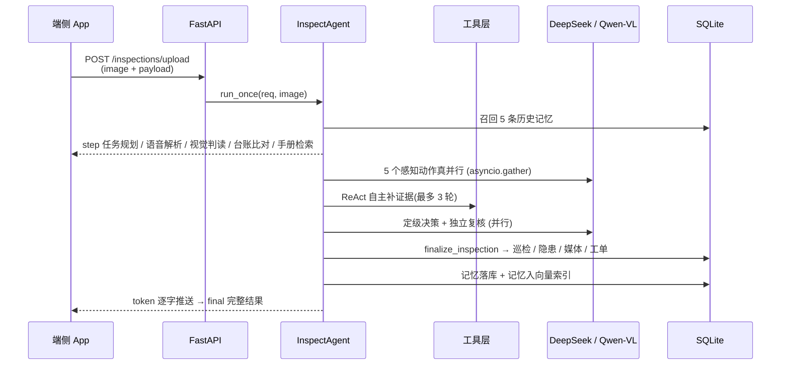
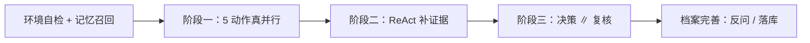
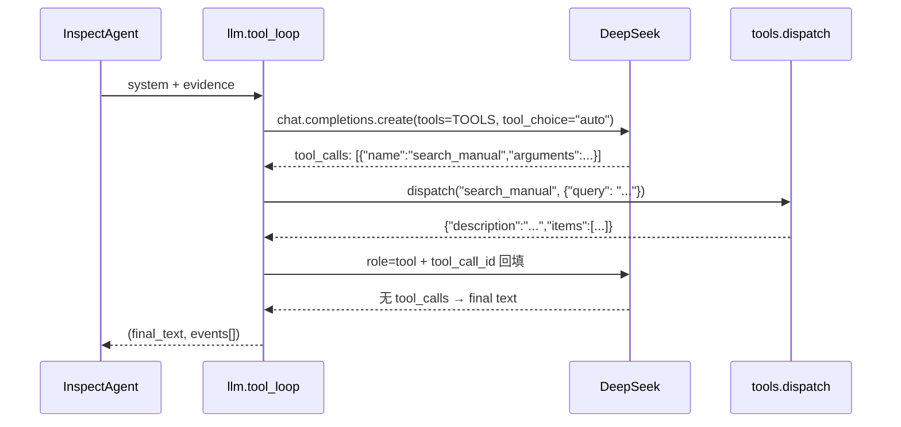
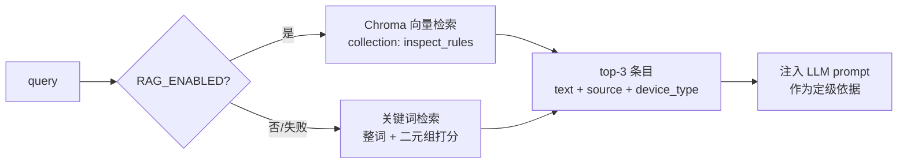
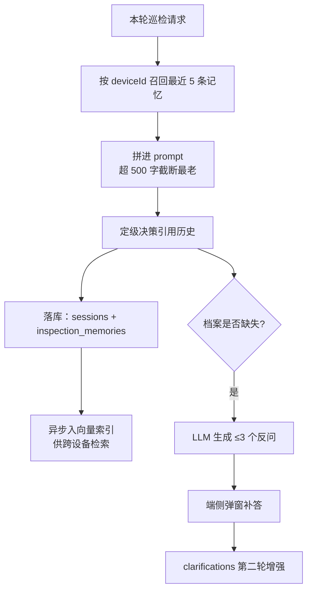

# 智巡 InspectAgent · 云端智能体服务

面向园区/配电房的智能巡检 Agent：**一次上传（图片 + 语音 + 传感器），六步推理，自动定级建单，缺信息自动反问**。

- 技术栈：Python 3.11 + FastAPI + SQLite + ChromaDB（可退化）+ OpenAI 兼容协议
- 模型：DeepSeek（文本推理 / 规划 / 定级）+ Qwen-VL（视觉判读）
- 端侧：HarmonyOS ArkTS（`D:\d\Huawei_project`），本文档描述云端 + 端云契约
- 交互：WebSocket 流式推送（步骤 / 子步骤 / 打字机 / 记忆命中），HTTP 一次性兜底

> 本文档只讲**架构、工具、知识库**。字段级契约见 [docs/api.md](docs/api.md)，表结构见 [docs/database.md](docs/database.md)。

---

## 1. 一分钟看懂

```
巡检员拍照 + 口述  →  云端 Agent 六步推理  →  四档定级 + 建议 + 工单
                          │
                          ├─ 有历史记忆 → 引用上次结论（"这台柜子上次 78℃"）
                          ├─ 证据不足   → 自主调工具补证据（ReAct）
                          ├─ 视觉不可读 → 请求重拍
                          └─ 档案不全   → 反问 3 个问题 → 端侧补答 → 第二轮增强
```

实测一条完整链路（真实模型、非 mock）：

| 指标 | 数值 |
|---|---|
| 端到端耗时 | 117.5 s |
| LLM 调用次数 | 22 次 |
| Token 总量 | 35 169（输入 18 611 / 输出 16 558） |
| 单次成本 | ¥0.1697 |
| 结果 | 紧急 · 置信度 0.47 · 3 条隐患 · 1 张工单 · 2 条历史记忆命中 |

---

## 2. 总体架构

### 2.1 七层能力栈

```mermaid
flowchart TB
    subgraph L7["L7 可观测层"]
        T1["agent_traces<br/>完整事件流 replay"]
        T2["token_usage<br/>用量 / 成本"]
        T3["alert_logs<br/>熔断 / 降级告警"]
        T4["归档与清理<br/>90 / 180 / 30 天"]
    end

    subgraph L6["L6 安全护栏层"]
        G1["置信度阈值 0.60<br/>低于则转人工"]
        G2["视觉/语音冲突检测<br/>封顶置信度"]
        G3["JSON Schema 校验<br/>坏 JSON 不落库"]
        G4["步骤超时 30s / 视觉 90s"]
    end

    subgraph L5["L5 记忆层"]
        M1["sessions<br/>会话上下文"]
        M2["inspection_memories<br/>按设备召回"]
        M3["记忆向量索引<br/>跨设备相似检索"]
    end

    subgraph L4["L4 Agent 核心"]
        A1["InspectAgent<br/>六步状态机"]
        A2["ReAct Loop<br/>证据够不够"]
        A3["ReviewAgent<br/>独立复核"]
        A4["VisionAgent<br/>视觉专岗"]
    end

    subgraph L3["L3 工具层"]
        W1["8 个 Function Calling 工具<br/>规范 / 台账 / 任务 / 联系人 / 重拍"]
    end

    subgraph L2["L2 检索增强"]
        R1["Chroma 向量检索"]
        R2["关键词检索兜底"]
        R3["110 条巡检语料"]
    end

    subgraph L1["L1 模型接入"]
        P1["DeepSeek<br/>规划 / 决策 / 复核 / 反问"]
        P2["Qwen-VL<br/>单图 / 四工具精判"]
        P3["重试 + 指数退避 + 熔断 + 并发闸"]
    end

    L1 --> L2 --> L3 --> L4 --> L5 --> L6 --> L7
```



### 2.2 请求链路



> WebSocket 模式（`/ws/agent/{session_id}`）与 HTTP 共用同一个 `InspectAgent.run()`，
> 差别只在于事件是逐条 `send_json` 还是一次性收集。**端侧 WS 断了必须能降级到 HTTP。**

### 2.3 目录结构

```
inspectagent-cloud/
├─ app/
│  ├─ main.py                 入口 + 同步/归档/告警/统计端点 + 静态挂载
│  ├─ config.py               所有开关集中在此（模型、阈值、价格、RAG 开关）
│  ├─ schemas.py              端云数据契约（字段与端侧 ets/model 一一对应）
│  ├─ routers/
│  │  ├─ tasks.py             任务 / 设备 / 工单 / 配置
│  │  ├─ inspections.py       巡检上报（multipart / JSON）
│  │  ├─ kb.py                知识库状态 / 重建
│  │  └─ ws.py                WebSocket 流式
│  ├─ agent/
│  │  ├─ state_machine.py     六步状态机 + ReAct + 记忆 + 反问（核心）
│  │  ├─ tools.py             8 个 Function Calling 工具 + dispatch 路由
│  │  ├─ review_agent.py      独立复核员（防误报 / 防漏报）
│  │  └─ vision_agent.py      视觉专岗（单判 / 四工具精判）
│  └─ services/
│     ├─ llm.py               DeepSeek 封装（chat / chat_json / tool_loop / stream）
│     ├─ vision.py            Qwen-VL 封装（4 个视觉工具）
│     ├─ rag.py               Chroma 检索 + 关键词兜底 + 记忆索引
│     └─ store.py             SQLite（16 张表 / v8 迁移 / 归档 / 统计 / 定时清理）
├─ knowledge/rules.md         RAG 语料（110 条）
├─ web/                       豆包风格测试台（纯静态，无内联脚本）
├─ scripts/
│  ├─ dev.ps1                 一键启动
│  ├─ test_llm.py             模型连通性自检
│  ├─ testimg.py              生成测试用配电柜图
│  └─ test_full_flow.py       端到端全流程验证
├─ docs/api.md                端云接口契约 ★
├─ docs/database.md           数据库表设计 ★
└─ data/                      inspect.db / uploads / chroma（运行期生成）
```

---

## 3. 六步状态机（Agent 核心）

### 3.1 三阶段执行



| 阶段 | 步骤 | 实现 | 耗时特征 |
|---|---|---|---|
| 阶段一 | 任务规划 | LLM 拆解检查项 | LLM |
| 阶段一 | 语音解析 | LLM 抽结构化槽位 | LLM |
| 阶段一 | 视觉判读 | Qwen-VL（单判 / 四工具精判） | VLM，最慢 |
| 阶段一 | 台账比对 | **纯本地规则，0 次 LLM** | 毫秒级 |
| 阶段一 | 手册检索 | RAG top-3 | 毫秒级 |
| 阶段二 | ReAct | 原生 Function Calling，最多 3 轮 | LLM |
| 阶段三 | 定级决策 | LLM 输出级别 / 置信度 / 建议 | LLM |
| 阶段三 | 独立复核 | ReviewAgent 并行，只看证据不看结论 | LLM |

阶段一 5 个动作通过 `asyncio.gather` 并发（同步 SDK 卸载到线程池），总耗时≈最慢的视觉判读；
阶段三决策与复核同样并行。

### 3.2 子步骤事件

每个 `StepOut` 带 `subSteps` 数组，用来把 Agent 的真实推理过程透出给界面：

```json
{"name": "定级决策", "status": "done", "detail": "紧急（置信度 0.47）",
 "subSteps": [
   {"text": "Agent 自主决策环：检查证据是否充分，不足则自动调工具补证据", "level": 2},
   {"text": "Round 1: 调 search_manual({\"query\": \"母线接头温度限值\"})", "level": 3},
   {"text": "Round 2: 调 get_device_profile({\"deviceId\": \"D-3001\"})", "level": 3},
   {"text": "ReviewAgent verdict: 存疑 → 建议异常，置信度 0.6", "level": 2}
 ]}
```

`level` 1/2/3 = 主步骤 / 子行 / 细节行，前端按层级缩进渲染即可（测试台已实现）。

### 3.3 定级与护栏

| 规则 | 行为 |
|---|---|
| 四档级别 | 正常 / 关注 / 异常 / 紧急 |
| 置信度 < 0.60 | `needHuman = true`（端侧显示"转人工复核"） |
| 视觉不可读 | 置信度封顶 0.60 + 请求重拍 |
| 视觉与语音冲突 | 置信度封顶 0.60 |
| 复核 verdict = 驳回 | 上调级别并转人工 |
| 异常 / 紧急 | 自动生成工单 `WO-xxxxxx` |
| LLM 连续失败 ≥3 次 | 本轮降级 mock 结果 + 写 `alert_logs` |

---

## 4. 工具调用（Function Calling）

### 4.1 工具清单

工具定义在 `app/agent/tools.py` 的 `TOOLS`（标准 OpenAI `tools` JSON Schema），
执行统一走 `dispatch(name, args)`，**永远返回 JSON 字符串，永远不抛异常**。

| 工具 | 入参 | 作用 | 底层 |
|---|---|---|---|
| `search_manual` | `query` | 检索巡检规程条款，补定级依据 | `rag.search` top-3 |
| `get_device_profile` | `deviceId` | 查台账：额定温度/湿度/安装日期/历史 | `store.get_device_profile` |
| `get_task` | `taskId` | 查任务详情：标题/设备/优先级/截止时间 | `store.get_task` |
| `list_devices` | 无 | 全量设备清单（最多返回 20 条） | `store.list_devices` |
| `get_config` | 无 | 阈值 / mock 状态 / 模型可用性 | `settings` |
| `similar_devices` | `deviceType`, `excludeDeviceId` | 同类设备对比（隔壁柜子温度也高吗） | `store.list_devices` 过滤 |
| `get_contacts` | `deviceId`, `area` | 应急联系人 / 责任人 / 维修班组 | 内置联系人（生产接用户表） |
| `ask_user_reshoot` | `reason`, `suggestion` | 图像不可读时请求重拍，返回中文提示 | 纯文本构造 |

**注册新工具三步**：① 在 `TOOLS` 加 schema ② 在 `dispatch` 加分支 ③ 端侧无需改动（工具由模型自主调用）。

### 4.2 原生 Function Calling（不是提示词拼 JSON）



关键点：

- 模型返回 `message.tool_calls`，服务端按 `tool_call_id` 回填 `role="tool"` 结果，**契约由 API 保证**
- `llm.tool_loop()` 最多 3 轮，每轮记录 `{"round", "type": "thought"|"tool", "name", "args", "observation"}`
- 达到上限时补一条"已达最大轮数，停止补充证据"，不静默截断
- 任何异常返回 `("", events)`，定级链路不中断

### 4.3 实际运行记录

```
🧠 Agent 自主决策环：检查证据是否充分，不足则自动调工具补证据
🔧 Round 1: search_manual({"query": "低压配电柜母线/接头温度限值 多少度算异常或紧急"})
🔧 Round 2: get_device_profile({"deviceId": "D-3001"})
🔧 Round 3: list_devices({})
🧠 Round 3: 已达最大轮数 3，停止补充证据
```

另一条样本中模型判断"证据充分，未再调用工具"，并在图像模糊时自主调用 `ask_user_reshoot` 请求重拍。

### 4.4 视觉工具（VLM 专岗，不是 FC）

`VISION_MODE` 决定视觉判读深度，由请求的 `mode` 覆盖：

| 模式 | 内部工具调用 | 调用次数 | 适用 |
|---|---|---|---|
| `quick` / `single` | `analyze` 一次综合判读 | 1 次 VLM | 默认，快 |
| `detailed` / `multi` | `assess_readable` → `read_meter` + `detect_defect` + `check_environment` | 4 次 VLM | 演示多智能体协作，慢但细 |

不可读时直接返回 `readable=false` 的确定性结构，**绝不臆造读数**。

---

## 5. 知识库（RAG）

### 5.1 语料构成（`knowledge/rules.md`，110 条）

| 分组 | 条数 | 典型限值 / 判据 | 主要来源 |
|---|---|---|---|
| 低压配电柜 | 16 | 母线接头 ≤70℃；绝缘 ≥0.5MΩ；温升 ≤60K | GB/T 14048.1、GB 7251.1、DL/T 596 |
| 高压柜 | 16 | 导电回路 ≤70℃；相温差 ≤15K；放电痕迹即紧急 | GB/T 11022、GB 50060、DL/T 596 |
| 干式变压器 | 16 | 绕组 >100℃ 报警、>120℃ 停电；温升 ≤100K | GB 1094.11、JB/T 10236 |
| 直流屏 | 16 | 单体 <2.20V 异常；鼓包漏液紧急；容量 ≥80% | DL/T 724、DL/T 596 |
| 电缆沟 | 16 | 接头 ≤70℃；导体长期 ≤90℃；积水关注/长期异常 | GB 50168、GB 50217 |
| 消防器材 | 16 | 压力表红区异常；过期送检；通道堵塞关注 | GB 50140、GB 50444、GB 50229 |
| 故障树与根因 | 6 | 发热+焦味、放电+闪烁、变压器温升、蓄电池鼓包、沟内积水、SF6 失压 | 自建故障树 |
| 历史案例 | 4 | 4 个真实处置案例（原因 → 处置 → 结果） | 项目沉淀 |
| 处置优先级 | 4 | 紧急 30 分钟 / 异常 24 小时 / 关注 7 天 / 正常归档 | 运行规程 |

条目统一格式，便于解析与引用：

```
- <检查项>：<限值 / 正常态 / 异常判据>【来源:标准名或手册名】
```

### 5.2 检索链路



- 语料启动时解析进内存 `_CORPUS`，`warmup()` 不联网、不建索引，耗时 <10 ms
- `RAG_ENABLED=0`（默认）走关键词，零依赖、零下载；设为 1 才建 Chroma 索引
- Chroma 不可用 → 自动退化关键词 + 写 `alert_logs(warn, rag)`，**绝不影响巡检主流程**
- 所有 Chroma 操作包在 `threading.Lock` 内，避免并发写集合
- 另有 `inspection_memories` collection：历史巡检结论入向量库，支持跨设备相似检索

### 5.3 扩充知识库

1. 按格式在 `knowledge/rules.md` 追加条目（新设备类型用 `## 设备名` 起新分组）
2. `POST /api/v1/kb/rebuild` 后台重建索引
3. `GET /api/v1/kb/stats` 确认条数与模式（`vector` / `keyword`）

> 不改代码即可扩充；每条都能通过 `【来源:xxx】` 在建议里保留出处。

---

## 6. 记忆与反问闭环



- 记忆存两处：结构化（`inspection_memories`）+ 向量（Chroma），召回时先精确后相似
- `memory_hit` 事件会把命中的历史推给端侧，界面可显示"上次这台设备是 78℃"
- 反问只在第一轮触发，且置信度 <0.85；第二轮带 `clarifications` 后不再追问，避免死循环
- 缺失字段取值：`visual_unreadable` / `voice_missing` / `sensor_missing` / `device_profile_missing`

---

## 7. 可观测与运维

| 能力 | 端点 / 表 | 说明 |
|---|---|---|
| Trace 回放 | `GET /api/v1/traces`、`/traces/{id}` | 完整事件流 JSON，可逐帧复现一次推理 |
| Token 成本 | `GET /api/v1/stats/tokens?days=7` | 总览 / 按天 / 按调用方 / 按模型 |
| 告警中心 | `GET /api/v1/alerts`、`POST /alerts/{id}/resolve` | LLM 熔断、RAG 降级、工具失败 |
| 数据归档 | `POST/DELETE /api/v1/admin/archive` | 90 天巡检归档，记忆 180 天、Trace 30 天清理 |
| 端侧同步 | `GET /api/v1/sync/snapshot`、`POST /sync/conflict` | 全量快照 / 增量（`since`）/ 冲突仲裁 |

Token 统计按调用方分桶，便于定位成本大头：

| caller | 来源 |
|---|---|
| `plan` / `decide` / `followup` | 状态机各阶段 |
| `react` | ReAct 工具循环（通常最贵） |
| `review` | 独立复核 |
| `voice` | 语音结构化 |
| `vision` | Qwen-VL（独立模型名，单独计价） |
| `stream` | 流式输出 |

计费默认 DeepSeek 官方价：输入 ¥2 / 百万 token，输出 ¥8 / 百万 token，可用环境变量覆盖。

---

## 8. 快速开始

```powershell
uv venv --python 3.11
. .\.venv\Scripts\Activate.ps1
uv pip install -r requirements.txt

Copy-Item .env.example .env
# 填入 DEEPSEEK_API_KEY / DASHSCOPE_API_KEY

python scripts\test_llm.py     # 模型连通性自检
.\scripts\dev.ps1              # 或 uvicorn app.main:app --reload --port 8000
```

- 接口文档：<http://localhost:8000/docs>
- Web 测试台：<http://localhost:8000/>
- 全流程验证：`python scripts\test_full_flow.py`（需服务已启动）

> 未配置任何 Key 时自动进入 mock：**接口结构完全一致，数据是假的**。`GET /health` 的
> `mock` 字段为 `true` 即处于该状态，**录屏演示前必须配好 Key 关掉它**。

### 关键配置项

| 环境变量 | 默认 | 说明 |
|---|---|---|
| `DEEPSEEK_MODEL` | `deepseek-chat` | 文本模型（方舟部署可填 `deepseek-v4-pro-ga-xxx`） |
| `QWEN_VL_MODEL` | `qwen-vl-max-latest` | 视觉模型（方舟可用 endpoint id） |
| `CONFIDENCE_THRESHOLD` | `0.60` | 低于则转人工 |
| `RAG_ENABLED` | `0` | 1 = 启用 Chroma 向量检索 |
| `EMBEDDING_MODEL` | 空 | 空则用 Chroma 内置 ONNX 模型 |
| `VISION_MODE` | `single` | `multi` = 四工具精判 |
| `LLM_PRICE_INPUT_PER_M` | `2.0` | 输入价格（元 / 百万 token） |
| `LLM_PRICE_OUTPUT_PER_M` | `8.0` | 输出价格（元 / 百万 token） |
| `MOCK_MODE` | 空 | 强制 mock 用于端侧联调 |

---

## 9. 相关文档

| 文档 | 内容 |
|---|---|
| [交付说明.md](交付说明.md) | **给端侧的一页纸**：起服务、联调 5 步、演示前检查、已知限制 |
| [docs/api.md](docs/api.md) | 39 个接口的 method / path / 参数 / 返回 / 示例 |
| [docs/database.md](docs/database.md) | 16 张表字段级设计、索引、ER 关系、生命周期 |
| `D:\d\Huawei_project\docs\端侧开发任务表.md` | 端侧单人从零实施路线 / 接口缺口 / 验收门槛 |
| `d:\d\未来杯\智巡InspectAgent_数据与接口总体规划.md` | 全局主纲（冲突时以主纲为准） |
