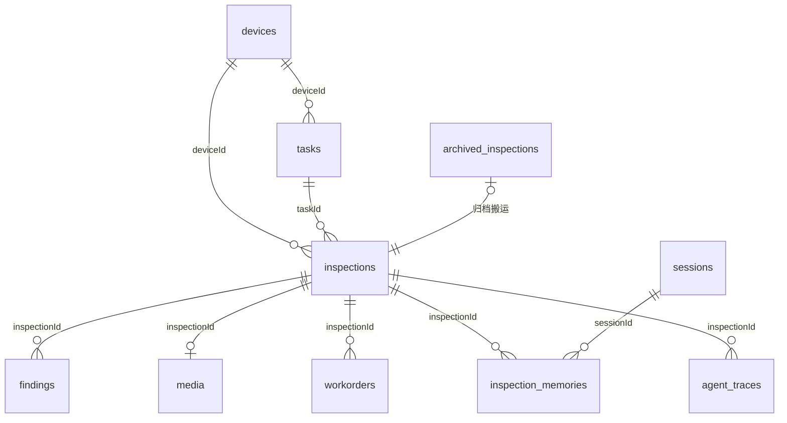
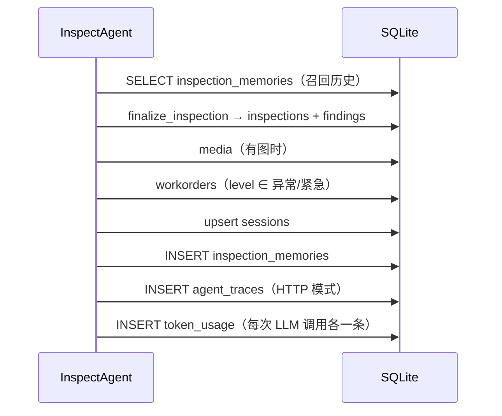

# 智巡 InspectAgent · 数据库表设计

- 引擎：SQLite 3（单文件 `data/inspect.db`），行工厂 `sqlite3.Row`
- 迁移：`schema_version` 表记录版本，当前 **v5**，启动时 `init_db()` 增量迁移
- 命名：所有列名 **小驼峰**，与 JSON key、ArkTS 字段三者同名（避免端云多一层映射）
- 时间：`TEXT`，格式 `YYYY-MM-DD HH:mm:ss`
- 布尔：`INTEGER`，0 / 1

---

## 1. 总览

| # | 表名 | 版本 | 用途 | 写入时机 |
|---|---|---|---|---|
| 1 | `devices` | v1 | 设备台账 | 种子数据 / 设备维护 |
| 2 | `tasks` | v1 | 巡检任务 | 种子数据 / 派单 |
| 3 | `inspections` | v1 | 巡检记录主表 | 每次巡检完成 |
| 4 | `findings` | v1 | 隐患 / 观测事实明细 | 巡检完成时批量写 |
| 5 | `workorders` | v1 | 工单 | 级别为异常 / 紧急时自动建 |
| 6 | `media` | v1 | 现场图片元数据 | 有图上传时 |
| 7 | `schema_version` | v1 | 迁移版本 | 每次迁移 |
| 8 | `sessions` | v2 | 会话上下文 | 巡检完成时 upsert |
| 9 | `inspection_memories` | v2 | 结构化记忆 | 巡检完成时 |
| 10 | `agent_traces` | v3 | 完整事件流 | HTTP 巡检结束后 |
| 11 | `archived_inspections` | v4 | 90 天外归档 | 手动 / 定时归档 |
| 12 | `alert_logs` | v4 | 生产告警 | LLM 熔断 / RAG 降级 / 工具失败 |
| 13 | `users` | v4 | 人员档案 | 登录 / 组织维护 |
| 14 | `token_usage` | v5 | Token 用量与成本 | 每次 LLM 调用 |
| 15 | `auth_tokens` | v6 | 登录 token（access / refresh） | 登录 / 刷新 / 登出 |

---

## 2. ER 关系

> 注意：SQLite 未声明外键约束（性能与历史库兼容考虑），关联关系由应用层保证。

---

## 3. 表结构

### 3.1 `devices` 设备台账

| 字段 | 类型 | 约束 | 说明 |
|---|---|---|---|
| id | TEXT | PK | 设备编号，如 `D-3001` |
| name | TEXT | | 设备名，如 `1号低压配电柜` |
| type | TEXT | | 设备类型：低压配电柜 / 高压柜 / 干式变压器 / 直流屏 / 电缆沟 / 消防器材 |
| location | TEXT | | 位置，如 `配电房A区` |
| ratedTemp | REAL | | 额定温度（℃），台账比对基准 |
| ratedHumidity | REAL | | 额定湿度（%RH） |
| installDate | TEXT | | 安装日期 |
| lastInspectAt | TEXT | | 上次巡检时间 |
| history | TEXT | | 历史摘要文本 |
| qrCode | TEXT | | 二维码内容（端侧扫码定位） |

### 3.2 `tasks` 巡检任务

| 字段 | 类型 | 约束 | 说明 |
|---|---|---|---|
| id | TEXT | PK | `T-1001` |
| deviceId | TEXT | | 关联设备 |
| title | TEXT | | 任务标题 |
| deviceName | TEXT | | 冗余设备名（端侧直接展示） |
| location | TEXT | | 位置 |
| status | TEXT | | 待巡检 / 进行中 / 已完成 |
| priority | TEXT | | 高 / 中 / 低 |
| deadline | TEXT | | 截止日期 |
| assignee | TEXT | | 指派人 |
| startedAt | TEXT | | 开始时间 |
| completedAt | TEXT | | 完成时间 |
| inspectionId | TEXT | | 完成后回填的巡检记录 |

索引：`idx_task_status(status)`

### 3.3 `inspections` 巡检记录（主表）

| 字段 | 类型 | 约束 | 说明 |
|---|---|---|---|
| id | TEXT | PK | `IN-YYYYMMDD-xxxx` |
| taskId | TEXT | | 任务编号 |
| deviceId | TEXT | | 设备编号 |
| deviceName | TEXT | | 设备名 |
| location | TEXT | | 位置 |
| operator | TEXT | | 巡检人 |
| voiceText | TEXT | | 语音原始文本（含第二轮 `[补答]`） |
| voiceSlotsJson | TEXT | JSON | `VoiceOut` 结构化槽位 |
| visionJson | TEXT | JSON | `VisionOut` 视觉判读结果 |
| sensorJson | TEXT | JSON | 温湿度 / 噪声 / `simulated` |
| imageId | TEXT | | 关联 `media.id` |
| level | TEXT | | 正常 / 关注 / 异常 / 紧急 |
| confidence | REAL | | 0~1 |
| advice | TEXT | | 处置建议（≤120 字） |
| needHuman | INTEGER | 默认 0 | 是否转人工 |
| mock | INTEGER | 默认 0 | 是否 mock 数据 |
| stepsJson | TEXT | JSON | 六步 `StepOut[]`（含 subSteps） |
| workOrderId | TEXT | | 自动生成的工单 |
| durationMs | INTEGER | | 端到端耗时 |
| capturedAt | TEXT | | 现场采集时刻（离线补传时还原） |
| createdAt | TEXT | | 落库时刻 |

索引：`idx_insp_device(deviceId)`、`idx_insp_time(createdAt DESC)`

### 3.4 `findings` 隐患明细

| 字段 | 类型 | 约束 | 说明 |
|---|---|---|---|
| id | INTEGER | PK AUTOINCREMENT | 自增 |
| inspectionId | TEXT | | 所属巡检 |
| item | TEXT | | 检查项，如 `母线接头温度` |
| value | TEXT | | 观测值，如 `85℃（限值 70℃）` |
| abnormal | INTEGER | 默认 0 | 是否异常 |
| basis | TEXT | | 依据：视觉判读 / 台账比对 / 手册检索 / 传感器 / 语音描述 |
| sortOrder | INTEGER | 默认 0 | 展示顺序 |

索引：`idx_find_insp(inspectionId)`

### 3.5 `workorders` 工单

| 字段 | 类型 | 约束 | 说明 |
|---|---|---|---|
| id | TEXT | PK | `WO-xxxxxx` |
| inspectionId | TEXT | | 来源巡检 |
| taskId | TEXT | | 来源任务 |
| deviceId / deviceName | TEXT | | 设备 |
| level | TEXT | | 关联级别 |
| description | TEXT | | 故障描述 / 建议 |
| assignee | TEXT | | 处理人 / 班组 |
| status | TEXT | | 待处理 / 处理中 / 已闭环 |
| handleNote | TEXT | | 处理说明 |
| createdAt / closedAt | TEXT | | 创建 / 闭环时间 |

### 3.6 `media` 媒体元数据

| 字段 | 类型 | 约束 | 说明 |
|---|---|---|---|
| id | TEXT | PK | 文件 ID |
| inspectionId | TEXT | | 所属巡检 |
| kind | TEXT | | image / audio |
| fileName | TEXT | | 落盘文件名（`data/uploads`） |
| mimeType | TEXT | | image/jpeg 等 |
| sizeKb | INTEGER | | 文件大小 |
| createdAt | TEXT | | 上传时间 |

访问路径：`GET /media/{fileName}`（静态挂载）。

### 3.7 `schema_version` 迁移版本

| 字段 | 类型 | 约束 | 说明 |
|---|---|---|---|
| version | INTEGER | PK | 当前版本号（1~5） |

迁移策略：无 `schema_version` 的旧库直接重建（初赛数据无历史价值）；
有版本号则按 `v < N` 逐级增量迁移，幂等。

### 3.8 `sessions` 会话上下文

| 字段 | 类型 | 约束 | 说明 |
|---|---|---|---|
| id | TEXT | PK | 会话 ID（WS 路径参数 / HTTP 生成） |
| taskId / deviceId / deviceType / location / operator | TEXT | | 当轮上下文快照 |
| createdAt / updatedAt | TEXT | | 创建 / 更新 |
| lastInspectionId | TEXT | | 最近一次巡检 |

### 3.9 `inspection_memories` 结构化记忆

| 字段 | 类型 | 约束 | 说明 |
|---|---|---|---|
| id | INTEGER | PK AUTOINCREMENT | 自增 |
| inspectionId | TEXT | | 来源巡检 |
| sessionId | TEXT | | 来源会话 |
| deviceId / deviceType | TEXT | | 用于按设备召回 |
| level | TEXT | | 当次级别 |
| summary | TEXT | | 结论摘要（≤120 字） |
| keywords | TEXT | | `findings.item` 用竖线拼接，供关键词召回 |
| capturedAt | TEXT | | 现场时刻 |
| createdAt | TEXT | | 落库时刻 |

索引：`idx_mem_device(deviceId)`
生命周期：默认保留 **180 天**（`cleanup_expired_memories`）。

### 3.10 `agent_traces` 完整事件流

| 字段 | 类型 | 约束 | 说明 |
|---|---|---|---|
| id | INTEGER | PK AUTOINCREMENT | Trace ID |
| sessionId | TEXT | | 会话 |
| inspectionId | TEXT | | 巡检记录 |
| taskId / deviceId / deviceName | TEXT | | 冗余便于检索 |
| level / confidence | TEXT / REAL | | 结论快照 |
| durationMs | INTEGER | | 总耗时 |
| eventsJson | TEXT | JSON | **完整事件流数组**（step / sub_step / token / memory_hit / final） |
| createdAt | TEXT | | 落库时刻 |

索引：`idx_trace_session(sessionId)`、`idx_trace_time(createdAt DESC)`
生命周期：默认保留 **30 天**（`cleanup_old_traces`）。
用途：`GET /api/v1/traces/{id}` 可逐帧回放一次推理（演示复盘 / 问题定位）。

### 3.11 `archived_inspections` 历史归档

| 字段 | 类型 | 约束 | 说明 |
|---|---|---|---|
| id | TEXT | PK | 原巡检 ID |
| taskId / deviceId / deviceName / location / operator | TEXT | | 冗余字段 |
| voiceText | TEXT | | 语音原文 |
| level / confidence / advice / needHuman | TEXT / REAL / TEXT / INTEGER | | 结论 |
| createdAt | TEXT | | 原创建时间 |
| archivedAt | TEXT | | 归档时间 |

索引：`idx_arch_time(createdAt DESC)`
规则：主表 > **90 天**的记录搬到此表，主表保持轻量；归档后可继续查询但不参与实时统计。

### 3.12 `alert_logs` 告警日志

| 字段 | 类型 | 约束 | 说明 |
|---|---|---|---|
| id | INTEGER | PK AUTOINCREMENT | 自增 |
| level | TEXT | | info / warn / error / critical |
| category | TEXT | | llm / rag / db / tool / vision |
| message | TEXT | | 一句话描述 |
| detail | TEXT | | 异常详情（≤200 字） |
| resolved | INTEGER | 默认 0 | 是否已处理 |
| createdAt | TEXT | | 产生时刻 |

索引：`idx_alert_level(level)`、`idx_alert_time(createdAt DESC)`

### 3.13 `users` 人员档案

| 字段 | 类型 | 约束 | 说明 |
|---|---|---|---|
| id | TEXT | PK | 人员 ID |
| name | TEXT | | 姓名 |
| role | TEXT | 默认 inspector | inspector / reviewer / admin |
| team | TEXT | | 班组 |
| phone | TEXT | | 联系电话 |
| lastLoginAt | TEXT | | 最近登录 |
| createdAt | TEXT | | 创建时间 |

> 当前 `inspections.operator` 仍是姓名文本；接入登录后可改为 `users.id`。

### 3.14 `token_usage` Token 用量与成本

| 字段 | 类型 | 约束 | 说明 |
|---|---|---|---|
| id | INTEGER | PK AUTOINCREMENT | 自增 |
| createdAt | TEXT | | 调用时刻 |
| model | TEXT | | `deepseek-v4-pro-ga-260813` / Qwen-VL endpoint |
| caller | TEXT | | plan / decide / react / review / followup / voice / vision / stream |
| sessionId | TEXT | | 会话 |
| promptTokens | INTEGER | 默认 0 | 输入 token |
| completionTokens | INTEGER | 默认 0 | 输出 token |
| totalTokens | INTEGER | 默认 0 | 合计 |
| costCny | REAL | 默认 0 | 人民币成本 |

索引：`idx_token_usage_time(createdAt)`
写入原则：**任何异常静默**，统计失败绝不影响巡检主流程。

---

## 4. 一次巡检的数据写入顺序

同一事务内先写主表再写明细，任一明细失败只记录告警、不回滚主记录。

---

## 5. 维护操作

| 操作 | 方式 | 影响 |
|---|---|---|
| 归档 | `POST /api/v1/admin/archive?days=90` | `inspections` → `archived_inspections` |
| 清理 | `DELETE /api/v1/admin/archive?days_memories=180&days_traces=30` | 删过期记忆与 Trace |
| 成本查询 | `GET /api/v1/stats/tokens?days=7` | 只读聚合 |
| 结构升级 | 改 `store.init_db()` 加 `if v < N:` 段 | 启动自动迁移 |
| 重建库 | 删除 `data/inspect.db` 后重启 | 重建 + 重新灌种子 |

新增表规范：

1. 在 `init_db()` 末尾追加 `if v < N:` 分支，`CREATE TABLE IF NOT EXISTS`
2. 补一条 `INSERT INTO schema_version VALUES(N)`
3. 同步本文档与 `docs/api.md` 的响应字段
4. 索引命名统一 `idx_<表缩写>_<字段>`

---

## 6. v6 迁移（P0 端侧优化，2026-11）

表数量由 **14 增至 15**（新增 `auth_tokens`）。

### 6.1 变更字段

| 表 | 字段 | 类型 | 说明 |
|---|---|---|---|
| `tasks` | `checklistJson` | TEXT | 检查项 JSON 数组，6 项，元素 `{key,name,required,status}` |
| `inspections` | `requestId` | TEXT | 端侧幂等键，空串不参与唯一约束 |
| `users` | `passwordHash` | TEXT | `pbkdf2$120000$<salt>$<hex>`，标准库实现，无额外依赖 |

### 6.2 新增表 `auth_tokens`

| 字段 | 类型 | 约束 | 说明 |
|---|---|---|---|
| `token` | TEXT | PK | `secrets.token_urlsafe(32)` |
| `userId` | TEXT | — | 关联 `users.id` |
| `kind` | TEXT | — | `access` / `refresh` |
| `expiresAt` | TEXT | — | `YYYY-MM-DD HH:mm:ss`，字符串可直接比较 |
| `revoked` | INTEGER | 默认 0 | 1 = 已吊销 |
| `createdAt` | TEXT | — | 签发时间 |

索引：`idx_auth_user(userId)`；`idx_insp_reqid(inspections.requestId) WHERE requestId <> ''`（部分唯一索引，允许多条空串）。

### 6.3 迁移时自动完成

1. `ALTER TABLE` 加上述三列
2. 建 `auth_tokens` 表与两个索引
3. 写入默认账号 `admin/admin123`、`inspector/inspector123`
4. 给所有历史任务按设备类型补 `checklistJson`

### 6.4 写入时机

| 动作 | 写入 |
|---|---|
| 登录成功 | `auth_tokens` 两条（access + refresh），`users.lastLoginAt` 更新 |
| 退出 | 对应 access token `revoked=1` |
| 上传（带 requestId） | `inspections.requestId` 落库；重复请求不写 |
| 任务置进行中 | 同 assignee 其他进行中任务 `status='待巡检'` |
| 任务置已完成 | `checklistJson` 全部 `done`，回填 `inspectionId` |

---

## 7. v7 迁移（P1 / P2，2026-11）

表数量不变（**15 张**），只加列 + 回填。

### 7.1 新增字段

| 表 | 字段 | 类型 | 说明 |
|---|---|---|---|
| `inspections` | `updatedAt` | TEXT | 服务端版本时间，v7 起为**增量同步与冲突仲裁的唯一依据** |
| `tasks` | `updatedAt` | TEXT | 同上；置进行中/已完成/被顶替时刷新 |
| `workorders` | `updatedAt` | TEXT | 同上；创建与状态流转时刷新 |
| `alert_logs` | `resolvedBy` | TEXT | 处理人 `users.id`（取自 token，不由前端传） |
| `alert_logs` | `resolvedAt` | TEXT | 处理时间 |
| `alert_logs` | `resolveNote` | TEXT | 处理备注 |
| `token_usage` | `userId` | TEXT | 由 `sessionId` 反查 `sessions.operator` → `users.id` |
| `token_usage` | `deviceId` | TEXT | 由 `sessions.deviceId` 反查 |
| `token_usage` | `traceId` | INTEGER | 关联 `agent_traces.id`，未回填时为 0 |

### 7.2 迁移时自动完成

1. `_ensure_column()` 幂等加列（列已存在不会中断，可重复执行）
2. 历史数据版本回填：
   - `inspections.updatedAt = COALESCE(capturedAt, createdAt)`
   - `tasks.updatedAt = COALESCE(completedAt, startedAt, deadline)`
   - `workorders.updatedAt = COALESCE(closedAt, createdAt)`
3. `schema_version` 写入 7

### 7.3 写入时机

| 动作 | 写入 |
|---|---|
| 巡检落库 | `inspections.updatedAt = 落库时刻` |
| 任务状态变更 / 被自动顶替 | `tasks.updatedAt = 变更时刻` |
| 工单创建 / 流转 | `workorders.updatedAt = 变更时刻` |
| 冲突仲裁接受端侧改动 | 对应表 `updatedAt` 刷新，返回新版本号 |
| 告警处理 | `resolved / resolvedBy / resolvedAt / resolveNote` |
| 每次 LLM 调用 | `token_usage` 追加 `userId / deviceId`（能反查时） |

### 7.4 索引说明

v7 未新增索引。`updatedAt` 上的增量查询走小表全表扫描（≤5000 条上限），
当前数据量下无需索引；若接入设备数超过 200，建议补
`CREATE INDEX idx_insp_updated ON inspections(updatedAt)`。
