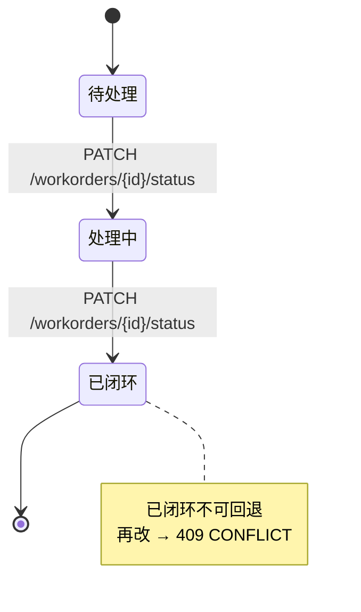
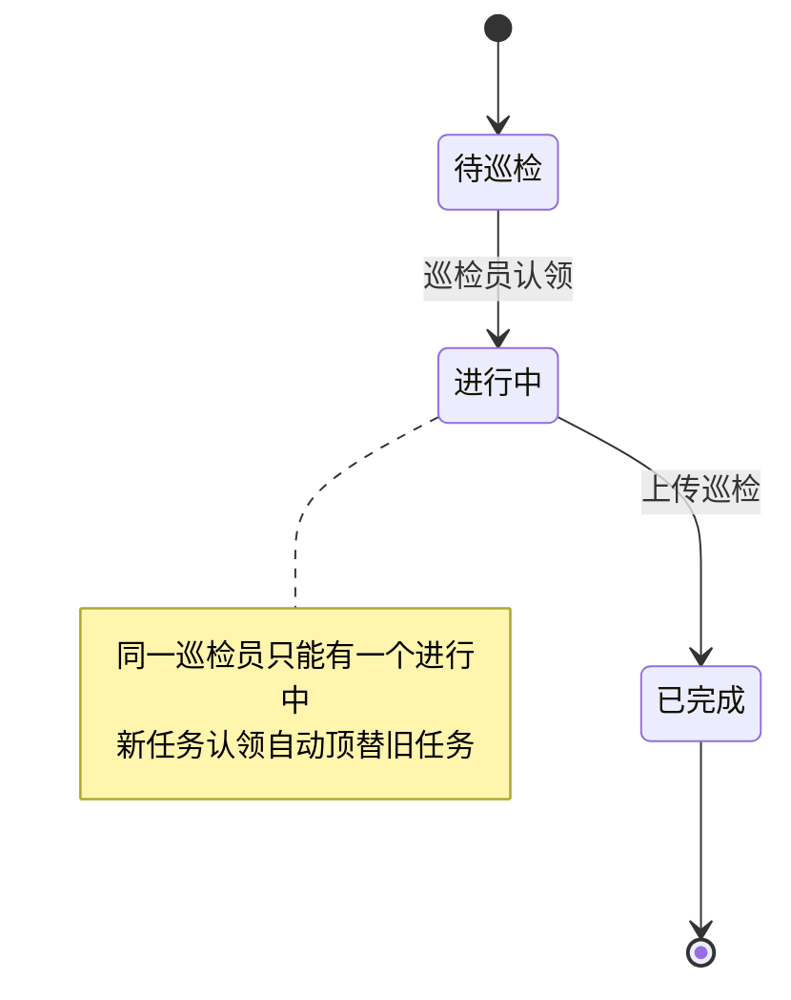

# 后端优化事项 · 完成回复

> 对应文档：`后端需优化事项.md`（P0 × 5、P1 × 7、P2 × 3，共 15 条）
> 交付版本：云端 v8（`schema_version=8`），仓库 `https://github.com/Chengzhen-del/Future-Cup.git`

---

## 一、结论

**15 条建议已全部落地，无一条"暂不支持"。** 另外把上一轮标注为"暂缓"的 7 项也补齐了：
缩略图、PDF 导出、删除巡检、`/media` 鉴权、`reviewer` 账号、定时清理、Trace 毫秒时间戳。

全量回归已跑通（真实 LLM + 真实 VLM，非 mock），验收记录见第四节。

---

## 二、15 条逐条对照

### P0（阻塞生产化）

| # | 原建议 | 落地情况 | 验收结果 |
|---|---|---|---|
| 1 | 任务接口补检查项与进度 | `TaskItem` 返回 `checklist[]`、`checklistTotal`、`checklistDone`、`inspectionId`；检查项含 `key/name/required/status` | `TASKS=6`，每条 6 个检查项，进度可算 |
| 2 | 一个巡检员只能一个进行中任务 | 采用「强制校验 + `isCurrent`」双保险：开始新任务自动顶替旧任务（旧任务回 `待巡检`），并在 `TaskItem` 返回 `isCurrent` | 同一 assignee 进行中恒为 1，`isCurrent` 唯一为 true |
| 3 | 登录 / 身份 / 权限接口 | `login / refresh / logout / me` 全部可用；token 落库（重启不掉线）；角色 `inspector / reviewer / admin`；新增 `app/security.py` 做 RBAC | `LOGIN_OK expiresIn=7200`；无 token → `401`；inspector 调归档 → `403` |
| 4 | 上传幂等键 | `POST /inspections/upload` 同时支持 form `requestId` 与 header `Idempotency-Key`，重复提交返回原记录并置 `duplicate=true` | 同 requestId 二次提交：同 inspectionId，`duplicate=True` |
| 5 | 检查项模板接口 | `GET /device-types`、`GET /device-types/{type}/checklist`；模板落了 6 类设备 | `checklist=6`（低压配电柜） |

### P1（状态与同步）

| # | 原建议 | 落地情况 | 验收结果 |
|---|---|---|---|
| 6 | 同步快照结构固定 | `SyncSnapshot.inspections` 固定为 `SyncInspection` 摘要（不含 findings/steps）；增量统一 `updatedAt > since`；返回 `serverTime`；`deleted` 下发删除墓碑 | `SYNC 200`；增量含 `deleted` |
| 7 | 冲突接口 Schema | 白名单：inspections(`level/confidence/advice/needHuman`)、workorders(`status/handleNote/assignee`)、tasks(`status/inspectionId`)。版本一致 → `winner=device`；否则 `winner=cloud`；记录不存在 → `resolved=false`（按云端已删除处理） | 两分支均实测：`winner=device` / `winner=cloud` |
| 8 | 错误响应统一 | 全站统一 `{code,message,detail,traceId}` + `X-Trace-Id`；覆盖 400/401/403/404/409/413/422/500；非法参数 422、已闭环工单回退 409 | `ERR404 / ERR422 / ERR401` 均为统一信封 |
| 9 | 列表分页与筛选 | tasks / devices / workorders / inspections / alerts / traces 全部支持 `page/pageSize` + 业务筛选；**不传 `page` 仍返回数组**，老端侧零改动 | `TASKS_PAGED total=6` |
| 10 | 图片 URL 规则 | `imageUrl` 永远是 `/media/{file}`；同时返回 `imageAbsoluteUrl`（基址优先 `PUBLIC_BASE_URL`，否则请求来源），**服务端已自动附加当前 token** | `INSP_LIST imageAbsoluteUrl` 可直接加载 |
| 11 | 报告详情字段 | 历史详情与 WS `final` 共用同一 `InspectResp`，你列的字段全部具备（另加 `voiceText`） | 详情/WS 字段一致 |
| 12 | 媒体生命周期 | 见第三节「新增能力」；策略接口 `/system/media-policy` 返回值全部为 `true` 且行为已落地 | `POLICY` 5 项全 true |

### P2（可观测与运维）

| # | 原建议 | 落地情况 | 验收结果 |
|---|---|---|---|
| 13 | Trace 事件结构 | `{seq,type,timestamp,stepName,payload}`，`seq` 递增可直接回放；新增 `eventCount`；时间戳升级为**毫秒** | `TRACE_DETAIL eventCount=110`，`ts=...56.850` |
| 14 | Alert 处理人/时间 | `resolvedBy / resolvedAt / resolveNote`；处理人取 token 里的 `userId`，不由前端传 | `RESOLVE ok=True resolvedBy=U-0003`（reviewer） |
| 15 | Token 统计维度 | 新增 `byUser / byDevice / bySession`，并回填 `traceId`（可按 Trace 下钻） | `TOKENS` 9 个维度键 |

---

## 三、本轮新增能力（此前"暂缓"的 7 项）

| 能力 | 接口 / 字段 | 说明 |
|---|---|---|
| 缩略图 | `imageThumbUrl` / `imageThumbAbsoluteUrl` | 长边 480px、JPEG q80；历史图片建库时自动补生成；列表首屏用它，省流量 |
| PDF 报告 | `GET /api/v1/inspections/{id}/report.pdf` | A4：基本信息 + 结论 + 逐项判读 + 现场照片 + 执行步骤；中文自动适配系统字体 |
| 删除巡检 | `DELETE /api/v1/inspections/{id}`（admin） | 连带删 findings / 原图 / 缩略图；写 `deleted_records` 墓碑供增量同步 |
| 媒体鉴权 | `GET /media/{file}` | `Authorization: Bearer` 或 `?token=` 均可；无 token → `401`；防路径穿越 |
| `reviewer` 账号 | `reviewer / reviewer123` | 只读 + 处理告警；不能上报巡检、不能删巡检 |
| 定时清理 | 内置后台任务 | 每 `CLEANUP_INTERVAL_HOURS`（默认 24h）清理记忆 / Trace / 已归档媒体；`0` 可关 |
| Trace 毫秒时间戳 | `agent_traces.createdAt`、事件 `timestamp` | 同轮事件可精确排序；老数据（秒级）仍兼容 |

新增环境变量：`CLEANUP_INTERVAL_HOURS=24`、`CLEANUP_DAYS_MEMORIES=180`、`CLEANUP_DAYS_TRACES=30`。

---

## 四、验收记录（真实模型，非 mock）

```text
LOGIN reviewer OK
POLICY        requiresAuth=true thumbnail=true pdf=true delete=true deleteWithInspection=true
UPLOAD        IN-20261105-9776  thumb=true  abs 带 token=true
MEDIA_NO_TOKEN 401 UNAUTHORIZED
MEDIA_TOKEN   200 image/jpeg 17KB
THUMB         200 1KB
PDF           200 application/pdf 108KB  %PDF
LIST_THUMB    true
DEL_INSPECTOR 403 FORBIDDEN
DEL_ADMIN     200 {"ok":true,"deleted":"IN-...","mediaFiles":2}
SYNC_DELETED  [{"tableName":"inspections","recordId":"IN-...","deviceId":"D-3001","deletedAt":"2026-11-05 10:29:57.101"}]
TRACE_DETAIL  eventCount=110  ts=2026-11-05 10:29:56.850（毫秒）
RESOLVE_BY_REVIEWER 200 U-0003
IDEMPOTENT    dup=false → dup=true（同 inspectionId，且秒级返回）
```

---

## 五、端侧只需要动这 4 处

1. **图片地址**：继续用 `imageAbsoluteUrl`，新增列表首屏用 `imageThumbAbsoluteUrl`。
   不要自己拼 token —— 服务端已按当前请求的 `Authorization` 自动追加 `?token=`。
2. **增量同步**：拿到 `deleted[]` 时删除本地副本；`since` 用上一次响应的 `serverTime`。
3. **错误处理**：按 `code` 分支，`message` 只用于展示；反馈问题时附上 `traceId`。
4. **权限 UI**：`inspector` / `reviewer` 隐藏"删除巡检"入口；告警处理只对 `admin` / `reviewer` 展示。

> 注意：图片 URL 里带的是 access token，**有效期 = token 有效期（默认 2 小时）**。
> token 刷新后请重新拉取列表/详情，或让 UI 在图片加载失败时用新 token 重新请求。

---

## 五-A、API 汇总表（method / path / 关键参数 / 谁调）

> 完整参数见 `docs/api.md`，这里只列端侧要调的 + 本 v8 新增/变更的。

### 认证

| Method | Path | 说明 | 关键参数 |
|---|---|---|---|
| POST | `/api/v1/auth/login` | 登录 | `username`、`password` → `accessToken`（有效期 2h）、`refreshToken`（7d）、`expiresIn`、`role` |
| POST | `/api/v1/auth/refresh` | 刷新 access token | `refreshToken` → 新 `accessToken` |
| POST | `/api/v1/auth/logout` | 登出 | header `Authorization: Bearer xxx` |
| GET | `/api/v1/auth/me` | 当前用户信息 | — |

### 核心业务（v8 变更）

| Method | Path | 说明 | 关键参数 |
|---|---|---|---|
| GET | `/api/v1/tasks` | 任务列表 | 可选 `page/pageSize`（不传 page 返回数组）；`status`、`deviceId` |
| GET | `/api/v1/tasks/{id}` | 任务详情（含 checklist 进度） | — |
| PATCH | `/api/v1/tasks/{id}/status` | 改任务状态 | `status`: `待巡检` / `进行中` / `已完成` |
| GET | `/api/v1/workorders` | 工单列表 | 可选 `page/pageSize`；`status`、`level`、`deviceId` |
| PATCH | `/api/v1/workorders/{id}/status` | 工单流转 | `status`: `待处理` / `处理中` / `已闭环`；**已闭环不可回退 → 409** |
| GET | `/api/v1/inspections` | 巡检历史列表 | 可选 `page/pageSize`；`level`、`deviceId`、`startTime`、`endTime` |
| **POST** | **`/api/v1/inspections/upload`** | **推荐上报（multipart 带图）** | `file image`、`Form payload`（JSON 字符串）、**可选 `Form requestId` 或 Header `Idempotency-Key`** |
| GET | `/api/v1/inspections/{id}` | 巡检详情 | — |
| **DELETE** | **`/api/v1/inspections/{id}`** | **v8 新增：删除巡检（仅 admin）** | — |
| **GET** | **`/api/v1/inspections/{id}/report.pdf`** | **v8 新增：PDF 报告** | query 参数可选 `?token=` |

### 同步与冲突（v7+）

| Method | Path | 说明 | 关键参数 |
|---|---|---|---|
| GET | `/api/v1/sync/snapshot` | 全量/增量快照 | 可选 `deviceId`、`since`（`updatedAt` 值） |
| POST | `/api/v1/sync/conflict` | 冲突仲裁 | 见下文完整 JSON 示例 |

### 告警 / Trace / Token

| Method | Path | 说明 | 谁调 |
|---|---|---|---|
| GET | `/api/v1/alerts` | 告警列表 | admin / reviewer |
| POST | `/api/v1/alerts/{id}/resolve` | 处理告警 | admin / reviewer，body `{note}` |
| GET | `/api/v1/traces` | Trace 列表 | admin |
| GET | `/api/v1/traces/{id}` | Trace 详情（完整事件流） | admin |
| GET | `/api/v1/stats/tokens` | Token 用量统计 | admin |
| GET | `/api/v1/system/media-policy` | 媒体策略（看有哪些能力） | 所有人 |

### 设备与知识库

| Method | Path | 说明 |
|---|---|---|
| GET | `/api/v1/devices` | 设备台账 |
| GET | `/api/v1/device-types` | 设备类型列表 |
| GET | `/api/v1/device-types/{type}/checklist` | 某类型设备的检查项模板 |
| GET | `/api/v1/kb/stats` | 知识库状态（向量/关键词） |

### 静态资源（v8 改为鉴权）

| Method | Path | 说明 | 鉴权方式 |
|---|---|---|---|
| GET | `/media/{fileName}` | 原图 / 缩略图 | `Authorization: Bearer xxx` 或 query `?token=xxx` |

### 运维（仅 admin）

| Method | Path | 说明 |
|---|---|---|
| POST | `/api/v1/admin/archive` | 归档 90 天前巡检 |
| DELETE | `/api/v1/admin/archive` | 清理过期记忆/Trace/已归档媒体 |

---

## 五-B、完整 JSON 示例（端侧建 model 直接抄）

### TaskItem（含 checklist 进度）

```json
{
  "id": "T-1001",
  "title": "3号低压配电柜日常巡检",
  "deviceId": "D-3001",
  "deviceName": "3号低压配电柜",
  "deviceType": "低压配电柜",
  "location": "A区配电房",
  "status": "进行中",          // 枚举：待巡检 / 进行中 / 已完成
  "priority": "高",             // 枚举：低 / 中 / 高
  "deadline": "2026-11-06 18:00:00",
  "assignee": "张工",
  "inspectionId": "",           // 完成后填；用于"从任务跳报告页"
  "checklistTotal": 6,
  "checklistDone": 2,
  "checklist": [
    {"key": "appearance",   "name": "柜体外观",    "required": true,  "status": "pending"},
    {"key": "temperature",  "name": "母线温度",    "required": true,  "status": "done"},
    {"key": "meter_read",   "name": "仪表读数",    "required": false, "status": "pending"},
    {"key": "smell",        "name": "有无异味",    "required": true,  "status": "done"},
    {"key": "ground",       "name": "接地螺栓",    "required": true,  "status": "pending"},
    {"key": "fire_equip",   "name": "消防器材",    "required": false, "status": "pending"}
  ],
  "isCurrent": true,            // v6：同一 assignee 只有一个为 true
  "updatedAt": "2026-11-05 10:30:00"
}
```

### SyncSnapshot（同步快照）

```json
{
  "since": "",                         // 本次请求回传的 since（首次为空）
  "sinceField": "updatedAt",           // 固定值，告诉端侧用哪个字段做增量
  "serverTime": "2026-11-05 23:59:59", // ← 下次请求把这个当 since 传回来
  "devices": [ /* DeviceItem 数组 */ ],
  "tasks": [ /* TaskItem 数组（同上） */ ],
  "workorders": [
    {
      "id": "WO-3A4035",
      "status": "待处理",              // 枚举：待处理 / 处理中 / 已闭环
      "level": "紧急",                  // 枚举：正常 / 关注 / 异常 / 紧急
      "deviceId": "D-3001",
      "deviceName": "1号低压配电柜",
      "description": "...",
      "assignee": "",
      "updatedAt": "2026-11-05 09:38:03"
    }
  ],
  "inspections": [
    {
      "inspectionId": "IN-20261105-0028",
      "taskId": "T-1001",
      "deviceId": "D-3001",
      "deviceName": "3号低压配电柜",
      "location": "A区配电房",
      "operator": "张工",
      "level": "正常",                  // 枚举：正常 / 关注 / 异常 / 紧急
      "confidence": 0.87,
      "advice": "温度正常，继续监控",
      "imageUrl": "/media/20261105_103144_05aab6.jpg",
      "imageAbsoluteUrl": "http://127.0.0.1:8000/media/20261105_103144_05aab6.jpg?token=xxx",
      "imageThumbUrl": "/media/20261105_103144_05aab6_thumb.jpg",
      "imageThumbAbsoluteUrl": "http://127.0.0.1:8000/media/20261105_103144_05aab6_thumb.jpg?token=xxx",
      "workOrderId": "",
      "capturedAt": "2026-11-05 10:30:00",
      "createdAt": "2026-11-05 10:31:44",
      "updatedAt": "2026-11-05 10:31:44",
      "needHuman": false,
      "mock": false
    }
  ],
  "deleted": [
    {
      "tableName": "inspections",
      "recordId": "IN-20261105-55b4",
      "deviceId": "D-3001",
      "deletedAt": "2026-11-05 10:32:00.101"  // 毫秒精度，与 since 同格式
    }
  ]
}
```

### 冲突请求 / 响应（白名单！不要整对象覆盖）

**请求**：只传白名单字段，且必须带 `cloudVersion`（端侧记录里的 `updatedAt`）。

```json
POST /api/v1/sync/conflict
{
  "table": "inspections",
  "id": "IN-20261104-8aeb",
  "cloudVersion": "2026-11-04 19:47:33",      // 端侧上次同步到的 updatedAt
  "deviceChanges": {
    "level": "关注",                           // 白名单字段
    "advice": "建议安排复测"                   // 白名单字段
  }
}
```

**白名单（其他字段会被忽略）**：

| table | 允许的字段 |
|---|---|
| `inspections` | `level`, `confidence`, `advice`, `needHuman` |
| `workorders` | `status`, `handleNote`, `assignee` |
| `tasks` | `status`, `inspectionId` |

**响应**：

```json
{
  "ok": true,
  "winner": "device",                        // 枚举：device / cloud
  "final": { /* 最终落库的完整对象 */ },     // winner=cloud 时忽略
  "cloudVersion": "2026-11-05 10:00:00",    // 最新 updatedAt，端侧用来更新本地版本
  "resolved": true                           // 记录不存在时为 false（按云端已删除处理）
}
```

### InspectResp（上传返回 / WS final / 历史详情 共用）

```json
{
  "sessionId": "SESS-xxxxxx",
  "inspectionId": "IN-20261105-0028",
  "taskId": "T-1001",
  "deviceId": "D-3001",
  "deviceName": "3号低压配电柜",
  "location": "A区配电房",
  "operator": "张工",
  "capturedAt": "2026-11-05 10:30:00",
  "voiceText": "柜体表面无异响，温度看起来在安全范围",
  "level": "正常",
  "confidence": 0.87,
  "advice": "温度正常，建议下次巡检复测螺栓紧固度",
  "needHuman": false,
  "workOrderId": "",
  "mock": false,
  "imageUrl": "/media/xxx.jpg",
  "imageAbsoluteUrl": "http://host/media/xxx.jpg?token=xxx",
  "imageThumbUrl": "/media/xxx_thumb.jpg",
  "imageThumbAbsoluteUrl": "http://host/media/xxx_thumb.jpg?token=xxx",
  "findings": [
    {"item": "母线接头温度", "value": "38℃", "abnormal": false, "basis": "DL/T 596：≤70℃"}
  ],
  "steps": [
    {"name": "任务规划", "status": "done", "detail": "...", "subSteps": [], "durationMs": 2200}
  ],
  "duplicate": false
}
```

### WorkOrder 状态机



### Task 状态机



---

## 五-C、WebSocket 事件类型（端侧 switch case 用）

WS URL：`ws://<host>/ws/agent/<session_id>?token=<accessToken>&mode=quick`

- `token`：access token（**必传**，query 形式）
- `mode`：`quick`（一次综合判读，默认）/ `detailed`（四工具精判，慢）
- 关闭 code：`1000` 正常、`1001` 客户端断、`1006` 服务端异常重连

**7 种事件**，全部 `{"type": "...", ...}` 结构：

| type | payload | 含义 | 端侧处理 |
|---|---|---|---|
| `status` | `{"text": "正在规划任务..."}` | 阶段提示（打字机效果） | 顶部提示条 |
| `step` | `{"name", "status", "detail", "subSteps", "durationMs"}` | 六步状态机每步 | 步骤列表动画 |
| `event` | `{"name": "memory_hit", "payload": {...}}` | 子事件：记忆命中 / 工具调用 / 反问 | 卡片弹窗 / 反问表单 |
| `clarify` | `{"questions": [...], "sessionId"}` | 云端反问 | 弹窗补答后重新 send `mode` + `clarifications` |
| `token` | `{"text": "..."}` | 逐字流式 token | 打字机拼接 |
| `final` | `InspectResp` 完整对象（见上） | **最终结果**，与 HTTP 返回完全同一 DTO | 跳报告页 |
| `end` | `{}` | 连接即将关闭 | 收尾 |

**幂等回放**：如果上传时带了 `requestId`，WS 断开重连后用同一个 `session_id` + `requestId`，服务端会直接回 `final` + `end`，不走 Agent。端侧判断 `final.duplicate=true` 时直接用缓存结果。

---

## 五-D、错误场景 → code 映射 + 端侧处理

所有错误返回统一信封：

```json
{
  "code": "VALIDATION_ERROR",
  "message": "status 只能是 已闭环/处理中/待处理",
  "detail": "...",
  "traceId": "94f7ea5c226d473d"
}
```

并带 Header：`X-Trace-Id: 94f7ea5c226d473d`。

| HTTP | code | 典型场景 | 端侧处理 |
|---|---|---|---|
| 400 | `BAD_REQUEST` | 参数格式错、body 缺必填 | 提示"参数错误"，不上报 traceId |
| **401** | **`UNAUTHORIZED`** | **token 过期/无效** | **立即调 `/auth/refresh`，成功后重放原请求；刷新也失败 → 跳登录页** |
| 403 | `FORBIDDEN` | 角色没权限（inspector 删巡检） | 按角色隐藏入口即可；意外出现提示"无权限" |
| **404** | **`NOT_FOUND`** | **记录被删、设备不存在** | **巡检/工单页面：清本地缓存 + 跳列表；图片 404：默认图** |
| **409** | **`CONFLICT`** | **工单已闭环回退、巡检版本冲突** | **工单：提示"已闭环不可回退"；冲突：调 `/sync/conflict` 仲裁** |
| 413 | `PAYLOAD_TOO_LARGE` | 图片超 10MB | 提示"图片过大，请重新拍摄" |
| **422** | **`VALIDATION_ERROR`** | **表单字段非法、状态值不在枚举** | **按字段名高亮，不弹 traceId；非法 token/requestId 会被服务端静默处理（幂等）** |
| 500 | `INTERNAL_ERROR` | 服务端异常 | 提示"服务暂不可用" + 重试按钮 + **附 traceId 反馈** |

---

## 五-E、时间 / 分页 / 上传 / 媒体 约定（容易踩坑的细节）

### 时间格式

| 字段 | 格式 | 时区 | 说明 |
|---|---|---|---|
| `createdAt / updatedAt / capturedAt / serverTime` | `YYYY-MM-DD HH:MM:SS`（秒精度） | **服务端本地时区**，统一 Asia/Shanghai | 无 `T`、无时区后缀 |
| `deletedAt` | `YYYY-MM-DD HH:MM:SS.sss`（毫秒精度） | 同上 | 墓碑用 |
| Trace 事件 `timestamp` | 毫秒精度 | 同上 | v8 升级后新数据毫秒，老数据仍可能秒级，**解析请用宽松格式** |

> **⚠️ 关键**：`since` 直接用服务端返回的 `serverTime` 字符串回传，**不要自己 parse 再 format**，避免格式漂移。

### 分页

| 场景 | 返回结构 | 说明 |
|---|---|---|
| **不传 `page`** | `array`（原始对象数组） | **老端侧零改动**，直接 `forEach` |
| 传 `page` + `pageSize` | `{items: [...], total, page, pageSize}` | `pageSize` 默认 20，最大 100 |
| 传了 `page` 但 total > items.length | 还有下一页 | `page++` 继续拉 |

### 上传 `POST /inspections/upload` Form 字段

```
Content-Type: multipart/form-data

file      image         图片文件（.jpg/.png/.webp，≤10MB，长边建议 ≤1600px）
Form      payload       JSON 字符串（不是 Form 对象！）
Form      requestId     （可选）幂等键；重复提交返回原记录 + duplicate=true
Header    Idempotency-Key （可选）同上，两个都传时 form 优先
```

**payload JSON 结构**（必填字段标 `*`）：

```json
{
  "taskId": "T-1001",                  // *
  "deviceId": "D-3001",                // *
  "deviceName": "3号低压配电柜",         // *
  "location": "A区配电房",
  "operator": "张工",                  // *
  "voiceText": "柜体无异响",
  "capturedAt": "2026-11-05 10:30:00", // 现场拍照时间
  "sensor": {
    "temperature": 42.5,
    "humidity": 55,
    "smoke": false
  }
}
```

### 媒体鉴权 URL 有效期

- `imageAbsoluteUrl` / `imageThumbAbsoluteUrl` 里的 `?token=` 复用 access token，**有效期 = access token 有效期（默认 2h）**
- token 刷新后，所有图片 URL 都会变成旧 token → **重新拉取列表/详情**即可拿到带新 token 的 URL
- 端侧图片组件建议：`onError` 时检查是否 401，如果是 → 刷新 token → 重拉该条数据
- **不要把图片 URL 存进本地 SQLite 做长期缓存**：token 过期后就失效；建议只存 `imageUrl`（相对路径）和 `imageThumbUrl`，展示时用最新 token 重拼

---

## 六、给端侧的几点建议

### 同步与离线（优先级最高）

1. **`since` 只用服务端 `serverTime`**，不要用手机本地时间。手机时钟漂移几分钟就会永久漏掉增量。
2. **`requestId` 一旦生成就不再更换**。弱网重试只重发网络请求，不重新生成 ID；否则幂等失效。
3. **本地离线队列按 `requestId` 去重**，成功后从队列移除；失败重试保持原 `requestId` 和原 `capturedAt`。
4. **冲突上报只传白名单字段**，不要整对象覆盖。整对象传会被 `rejected`，而且容易把云端新改动冲掉。

### 网络与图片

5. **上传前压图**：长边 ≤1600px、≤10MB（服务端硬上限 10MB）。现场弱网下这能决定成败。
6. **列表用缩略图，详情/报告页才用原图**。一张 17KB 缩略图 vs 108KB 原图，历史页翻页体感差别很大。
7. **图片加载失败要区分 404 和 401**：401 是 token 过期（刷新后重拉），404 是记录被删（清本地缓存）。

### 交互与状态

8. **列表超过 50 条就传 `page/pageSize`**，并用 `total` 做"加载更多"；不要一次拉 500 条。
9. **WS 断线重连后先拉一次 `/sync/snapshot`** 再继续，避免事件空洞。
10. **Trace 回放按 `seq` 排序**，`timestamp` 只用于展示（不同轮次可能跨秒）。
11. **卡片状态全部由接口驱动**（你们已经在做）：任务进度用 `checklistDone/checklistTotal`，
    不要用本地点击计数，否则顶替任务后进度会对不上。
12. **删除巡检后清本地图片缓存**，旧 URL 会 404。

### 演示建议

13. 演示时用三个账号各走一遍：`inspector` 上报 → `reviewer` 处理告警 → `admin` 导出 PDF / 删除记录，
    能完整展示"角色权限可验证"这一条。
14. 图片鉴权是内网演示口径，**不要把带 token 的图片 URL 贴到日志或外部文档**。

---

## 七、边界与已知限制

| 项 | 现状 |
|---|---|
| 图片签名 URL | 未做。目前复用 access token（2h），不做独立签名 |
| PDF 中文字体 | 优先系统字体（微软雅黑/黑体/宋体），无字体环境退化为 reportlab 内置 `STSong-Light` |
| `deleted_records` 清理 | 只增不删，当前量级可忽略；后续可并入定时清理 |
| 录音转写 | 仍只留证不转写（与初赛口径一致） |
| 删除巡检 | 硬删 + 墓碑，无回收站；如需软删请提需求 |

---

## 八、联调信息

- 地址：`http://<主机>:8000`，Swagger：`/docs`，Web 测试台：`/`
- 账号：`admin/admin123`、`inspector/inspector123`、`reviewer/reviewer123`
- 契约文档：`docs/api.md`（第 13 章为 v8 变更）、`docs/database.md`（第 8 章为 v8 迁移）
- 验收命令示例：

```bash
# 登录
curl -X POST http://127.0.0.1:8000/api/v1/auth/login \
  -H "Content-Type: application/json" \
  -d '{"username":"inspector","password":"inspector123"}'

# 导出 PDF（需 token）
curl -H "Authorization: Bearer $TOKEN" \
  http://127.0.0.1:8000/api/v1/inspections/IN-xxx/report.pdf -o report.pdf
```

有问题直接把 `traceId` 发我，服务端日志按它可定位到具体请求。
