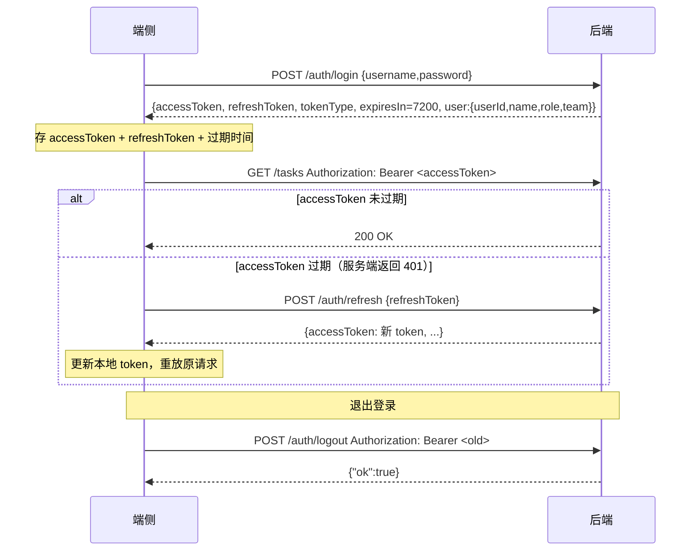
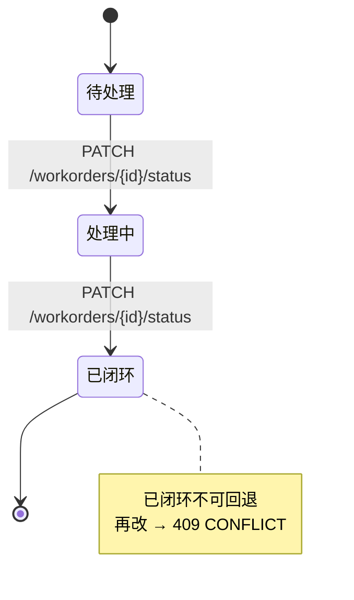
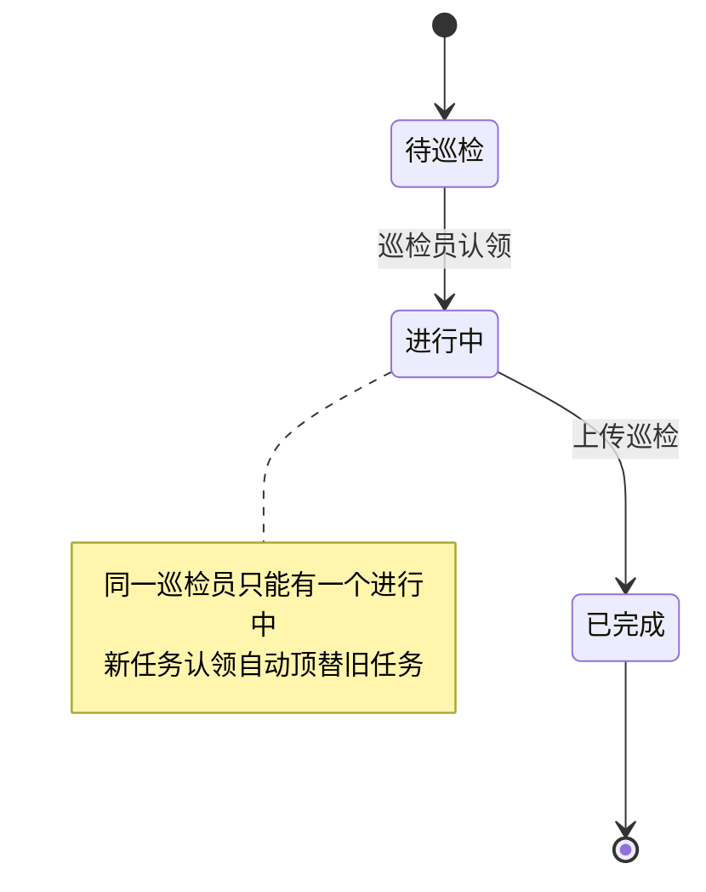

# 智巡 InspectAgent · 端侧开发一站式文档

> 云端版本：v8（`schema_version=8`）
> 仓库：`https://github.com/Chengzhen-del/Future-Cup.git`
> 后端 API 基址：`http://<主机>:8000`，Swagger：`http://<主机>:8000/docs`

---

## 0. 快速开始（3 分钟跑通）

### 服务地址

| 用途 | URL |
|---|---|
| 后端 API | `http://<主机 IP>:8000` |
| Swagger 接口文档 | `http://<主机 IP>:8000/docs` |
| Web 测试台（后端自带） | `http://<主机 IP>:8000/` |
| 健康检查 | `GET http://<主机 IP>:8000/health` → `{"ok":true,"mock":false}` |

### 默认账号

| 账号 | 密码 | 角色 | 能做什么 |
|---|---|---|---|
| `admin` | `admin123` | admin | 全部权限 |
| `inspector` | `inspector123` | inspector | 上报巡检、看任务/工单/历史、处理告警；**不能删巡检、不能归档** |
| `reviewer` | `reviewer123` | reviewer | 只读 + 处理告警；**不能上报巡检、不能删巡检** |

### 3 个 curl 先跑通

```bash
# 1) 登录拿 token
curl -X POST http://<host>:8000/api/v1/auth/login \
  -H "Content-Type: application/json" \
  -d '{"username":"inspector","password":"inspector123"}'
# → {"accessToken":"...","refreshToken":"...","tokenType":"Bearer","expiresIn":7200,
#    "user":{"userId":"U-0002","name":"inspector","role":"inspector","team":"巡检班组"}}

# 2) 拉任务列表（带 token）
curl -H "Authorization: Bearer $TOKEN" http://<host>:8000/api/v1/tasks?page=1&pageSize=5

# 3) 导出 PDF（admin）
curl -H "Authorization: Bearer $TOKEN" \
  http://<host>:8000/api/v1/inspections/IN-xxx/report.pdf -o report.pdf
```

---

## 1. 完整接口汇总（39 个，按功能分组）

### 1.1 认证（4 个）

| Method | Path | 说明 | 请求体 / 参数 | 关键返回 |
|---|---|---|---|---|
| POST | `/api/v1/auth/login` | 账号密码登录 | `{"username","password"}` | `accessToken`（2h）、`refreshToken`（7d）、`tokenType`、`expiresIn`、**`user:{userId,name,role,team}`** |
| POST | `/api/v1/auth/refresh` | 刷新 access token | `{"refreshToken"}` | 同 login |
| POST | `/api/v1/auth/logout` | 登出 | —（header `Authorization`） | `{"ok":true}` |
| GET | `/api/v1/auth/me` | 当前用户 | — | `{userId,name,role,team}` |

### 1.2 任务 / 工单 / 设备（9 个）

| Method | Path | 说明 | 关键参数 |
|---|---|---|---|
| GET | `/api/v1/tasks` | 任务列表 | 可选 `page/pageSize/status/deviceId`；**不传 page 返回数组** |
| GET | `/api/v1/tasks/{id}` | 任务详情（含 checklist 进度） | — |
| PATCH | `/api/v1/tasks/{id}/status` | 改任务状态 | body `{"status": "待巡检\|进行中\|已完成"}` |
| GET | `/api/v1/devices` | 设备台账 | 可选 `page/pageSize/deviceType` |
| GET | `/api/v1/devices/{id}` | 设备档案 | — |
| GET | `/api/v1/device-types` | 6 类设备模板列表 | — |
| GET | `/api/v1/device-types/{type}/checklist` | 某类型检查项模板 | `type`：低压配电柜 / 干式变压器 / ... |
| GET | `/api/v1/workorders` | 工单列表 | 可选 `page/pageSize/status/level/deviceId` |
| GET | `/api/v1/workorders/{id}` | 工单详情 | — |
| PATCH | `/api/v1/workorders/{id}/status` | 工单流转 | `{"status": "待处理\|处理中\|已闭环"}`；**已闭环不可回退 → 409** |

### 1.3 巡检（5 个）

| Method | Path | 说明 | 关键参数 |
|---|---|---|---|
| **POST** | **`/api/v1/inspections/upload`** | **推荐：multipart 带图上报** | `file image` + `Form payload`（JSON 字符串）+ 可选 `requestId` / Header `Idempotency-Key` |
| POST | `/api/v1/inspections` | 纯 JSON 上报（无图） | body `InspectReq` |
| GET | `/api/v1/inspections` | 巡检历史列表（SyncInspection 摘要） | 可选 `page/pageSize/level/deviceId/startTime/endTime` |
| GET | `/api/v1/inspections/{id}` | 巡检详情（InspectResp 完整 DTO） | — |
| **DELETE** | **`/api/v1/inspections/{id}`** | **v8 新增：删除巡检（仅 admin）** | 连带删 findings + 原图 + 缩略图 + 写墓碑 |
| **GET** | **`/api/v1/inspections/{id}/report.pdf`** | **v8 新增：PDF 报告（A4）** | `application/pdf` |

### 1.4 同步（2 个，端侧启动/离线恢复必用）

| Method | Path | 说明 | 关键参数 |
|---|---|---|---|
| GET | `/api/v1/sync/snapshot` | 全量 / 增量快照 | 可选 `deviceId`、`since`（**直接用上次返回的 `serverTime` 字符串**） |
| POST | `/api/v1/sync/conflict` | 冲突仲裁 | body 见第 4.4 节 |

### 1.5 WS 实时巡检（1 条 WS + 7 种事件）

- **URL**：`ws://<host>/ws/agent/<session_id>?token=<accessToken>&mode=quick`
- `token`（access token，必传）、`mode=quick`（默认，综合判读）/ `detailed`（四工具精判，慢）
- 事件类型：`status` / `step` / `event` / `clarify` / `token` / `final` / `end`（详见第 5 节）

### 1.6 告警 / Trace / Token 统计（5 个，admin / reviewer）

| Method | Path | 说明 | 谁调 |
|---|---|---|---|
| GET | `/api/v1/alerts` | 告警列表（含处理人/时间/备注） | admin / reviewer |
| POST | `/api/v1/alerts/{id}/resolve` | 处理告警 | admin / reviewer，body `{"note":"..."}` |
| GET | `/api/v1/traces` | Trace 列表（不含 events） | admin |
| GET | `/api/v1/traces/{id}` | Trace 详情（完整事件流，可回放） | admin |
| GET | `/api/v1/stats/tokens` | Token 用量统计（按天/调用方/模型/用户/设备/会话） | admin |

### 1.7 静态资源 + 运维（5 个）

| Method | Path | 说明 | 鉴权 |
|---|---|---|---|
| **GET** | **`/media/{fileName}`** | **v8 起为鉴权端点：原图 / 缩略图** | `Authorization: Bearer xxx` **或** `?token=xxx` |
| GET | `/api/v1/system/media-policy` | 媒体策略（看有哪些能力可用） | 所有人 |
| GET | `/health` | 健康检查 | 无 |
| GET | `/` | Web 测试台 | 无 |
| POST | `/api/v1/admin/archive` | 归档 90 天前巡检 | admin |
| DELETE | `/api/v1/admin/archive` | 清理过期记忆/Trace/已归档媒体 | admin |

### 1.8 知识库（2 个，可选）

| Method | Path | 说明 |
|---|---|---|
| GET | `/api/v1/kb/stats` | 知识库状态 |
| POST | `/api/v1/kb/rebuild` | 后台重建向量索引 |

---

## 2. 鉴权流程（端侧必须实现）



### 关键约定

- `accessToken` 默认有效期 **2 小时**
- `refreshToken` 默认有效期 **7 天**
- **刷新失败（401 + refreshToken 也过期）→ 必须跳登录页**
- 后端**不支持** refresh token 轮换（刷新后旧 refreshToken 仍有效），简化端侧实现

---

## 3. 完整数据模型 JSON 示例（ArkTS model 直接抄）

### 3.1 TaskItem（含 checklist 进度）

```json
{
  "id": "T-1001",
  "title": "3号低压配电柜日常巡检",
  "deviceId": "D-3001",
  "deviceName": "3号低压配电柜",
  "deviceType": "低压配电柜",
  "location": "A区配电房",
  "status": "进行中",
  "priority": "高",
  "deadline": "2026-11-06 18:00:00",
  "assignee": "张工",
  "inspectionId": "",
  "checklistTotal": 6,
  "checklistDone": 2,
  "checklist": [
    {"key": "appearance",   "name": "柜体外观", "required": true,  "status": "pending"},
    {"key": "temperature",  "name": "母线温度", "required": true,  "status": "done"},
    {"key": "meter_read",   "name": "仪表读数", "required": false, "status": "pending"},
    {"key": "smell",        "name": "有无异味", "required": true,  "status": "done"},
    {"key": "ground",       "name": "接地螺栓", "required": true,  "status": "pending"},
    {"key": "fire_equip",   "name": "消防器材", "required": false, "status": "pending"}
  ],
  "isCurrent": true,
  "updatedAt": "2026-11-05 10:30:00"
}
```

**枚举值**：

| 字段 | 枚举 |
|---|---|
| `status` | `待巡检` / `进行中` / `已完成` |
| `priority` | `低` / `中` / `高` |
| `checklist[].status` | `pending` / `done` / `skipped` |

### 3.2 InspectResp（上传返回 / WS final / 历史详情 共用）

```json
{
  "sessionId": "SESS-xxxxxx",
  "inspectionId": "IN-20261105-0028",
  "taskId": "T-1001",
  "deviceId": "D-3001",
  "deviceName": "3号低压配电柜",
  "location": "A区配电房",
  "operator": "张工",
  "capturedAt": "2026-11-05 10:30:00",
  "voiceText": "柜体表面无异响，温度看起来在安全范围",
  "level": "正常",
  "confidence": 0.87,
  "advice": "温度正常，建议下次巡检复测螺栓紧固度",
  "needHuman": false,
  "workOrderId": "",
  "mock": false,
  "imageUrl": "/media/xxx.jpg",
  "imageAbsoluteUrl": "http://host/media/xxx.jpg?token=xxx",
  "imageThumbUrl": "/media/xxx_thumb.jpg",
  "imageThumbAbsoluteUrl": "http://host/media/xxx_thumb.jpg?token=xxx",
  "findings": [
    {"item": "母线接头温度", "value": "38℃", "abnormal": false, "basis": "DL/T 596：≤70℃"}
  ],
  "steps": [
    {"name": "任务规划", "status": "done", "detail": "...", "subSteps": [], "durationMs": 2200}
  ],
  "duplicate": false
}
```

**枚举值**：`level` = `正常` / `关注` / `异常` / `紧急`

### 3.3 SyncInspection（同步/列表的巡检摘要）

```json
{
  "inspectionId": "IN-20261105-0028",
  "taskId": "T-1001",
  "deviceId": "D-3001",
  "deviceName": "3号低压配电柜",
  "location": "A区配电房",
  "operator": "张工",
  "level": "正常",
  "confidence": 0.87,
  "advice": "...",
  "imageUrl": "/media/xxx.jpg",
  "imageAbsoluteUrl": "http://host/media/xxx.jpg?token=xxx",
  "imageThumbUrl": "/media/xxx_thumb.jpg",
  "imageThumbAbsoluteUrl": "http://host/media/xxx_thumb.jpg?token=xxx",
  "workOrderId": "",
  "capturedAt": "2026-11-05 10:30:00",
  "createdAt": "2026-11-05 10:31:44",
  "updatedAt": "2026-11-05 10:31:44",
  "needHuman": false,
  "mock": false
}
```

### 3.4 SyncSnapshot（同步快照）

```json
{
  "since": "",
  "sinceField": "updatedAt",
  "serverTime": "2026-11-05 23:59:59",
  "devices": [ /* DeviceItem 数组 */ ],
  "tasks": [ /* TaskItem 数组（见 3.1） */ ],
  "workorders": [
    {
      "id": "WO-3A4035",
      "status": "待处理",
      "level": "紧急",
      "deviceId": "D-3001",
      "deviceName": "1号低压配电柜",
      "description": "...",
      "assignee": "",
      "updatedAt": "2026-11-05 09:38:03"
    }
  ],
  "inspections": [ /* SyncInspection 数组（见 3.3） */ ],
  "deleted": [
    {
      "tableName": "inspections",
      "recordId": "IN-20261105-55b4",
      "deviceId": "D-3001",
      "deletedAt": "2026-11-05 10:32:00.101"
    }
  ]
}
```

### 3.5 WorkOrder（工单）

```json
{
  "id": "WO-3A4035",
  "inspectionId": "IN-xxx",
  "taskId": "T-1001",
  "deviceId": "D-3001",
  "deviceName": "1号低压配电柜",
  "level": "紧急",
  "description": "立即停电核实焦味与高温...",
  "assignee": "李工",
  "status": "待处理",
  "handleNote": "",
  "createdAt": "2026-11-05 09:38:03",
  "updatedAt": "2026-11-05 09:38:03"
}
```

**枚举值**：`status` = `待处理` / `处理中` / `已闭环`；`level` = `正常` / `关注` / `异常` / `紧急`

### 3.6 冲突请求 / 响应（第 4.4 节详述）

---

## 4. 同步 / 冲突 / 删除墓碑机制

### 4.1 全量 vs 增量

```
首次启动：  GET /sync/snapshot                          → since=""，拉全量
之后：      GET /sync/snapshot?since=<上次的serverTime>  → 只拉 updatedAt > since 的增量
deviceId：  GET /sync/snapshot?deviceId=D-3001          → 只拉某设备数据
```

**⚠️ 关键**：`since` 直接把服务端返回的 `serverTime` 字符串原样回传，**不要自己 parse 再 format**，避免格式漂移。

### 4.2 deleted[] 墓碑

当别人（或 admin）删除了巡检，增量快照的 `deleted[]` 会下发：

```json
"deleted": [{"tableName":"inspections","recordId":"IN-xxx","deviceId":"D-3001","deletedAt":"..."}]
```

端侧收到 → 删本地对应记录 + 清本地图片缓存。**全量快照（since=""）不返回历史墓碑**。

### 4.3 冲突场景

场景：端侧离线时改了一条记录（比如改了巡检 `advice`），云端期间也改了同一条。同步上来后后端发现 `cloudVersion != 端侧 updatedAt`，这就产生冲突。

### 4.4 冲突仲裁请求 / 响应

**请求（POST `/api/v1/sync/conflict`）**：

```json
{
  "table": "inspections",
  "id": "IN-20261104-8aeb",
  "cloudVersion": "2026-11-04 19:47:33",
  "deviceChanges": {
    "level": "关注",
    "advice": "建议安排复测"
  }
}
```

**白名单字段（其他字段会被忽略）**：

| table | 允许的字段 |
|---|---|
| `inspections` | `level`, `confidence`, `advice`, `needHuman` |
| `workorders` | `status`, `handleNote`, `assignee` |
| `tasks` | `status`, `inspectionId` |

**响应**：

```json
{
  "ok": true,
  "winner": "device",
  "final": { /* 最终落库的完整对象 */ },
  "cloudVersion": "2026-11-05 10:00:00",
  "resolved": true
}
```

| 字段 | 含义 |
|---|---|
| `winner=device` | 端侧赢，改动被接受 |
| `winner=cloud` | 云端赢，端侧改动被覆盖，用 `final` 更新本地 |
| `resolved=false` | 云端已删除该记录，端侧同步时按墓碑处理 |

### 4.5 任务互斥（`isCurrent`）

- 同一 `assignee` 同时只能有一个 `进行中` 任务
- 巡检员认领新任务时，旧任务自动回 `待巡检`
- 服务端在 `TaskItem` 返回 `isCurrent`，端侧据此高亮"当前任务"
- **不要**用本地状态算 `isCurrent`，以服务端返回为准

---

## 5. WebSocket 实时巡检

### 5.1 连接

```
ws://<host>/ws/agent/<session_id>?token=<accessToken>&mode=quick
```

| 参数 | 必填 | 说明 |
|---|---|---|
| `session_id` | 是 | 端侧自己生成的唯一 ID（UUID） |
| `token` | 是 | access token，query 形式（WS 不走 Header） |
| `mode` | 否 | `quick`（默认，综合判读，快）/ `detailed`（四工具精判，慢） |

### 5.2 7 种事件（全部 `{"type":"...", ...}` 结构）

| type | payload | 含义 | 端侧处理 |
|---|---|---|---|
| `status` | `{"text":"正在规划任务..."}` | 阶段提示（打字机效果） | 顶部提示条 |
| `step` | `{"name","status","detail","subSteps","durationMs"}` | 六步状态机每步 | 步骤列表动画 |
| `event` | `{"name":"memory_hit","payload":{...}}` | 子事件：记忆命中 / 工具调用 / 反问 | 卡片弹窗 / 反问表单 |
| `clarify` | `{"questions":[...],"sessionId"}` | 云端反问（缺信息） | 弹窗补答后 send `{mode, clarifications}` |
| `token` | `{"text":"..."}` | 逐字流式 token | 打字机拼接 |
| `final` | `InspectResp`（完整对象，同 3.2） | **最终结果** | 跳报告页 |
| `end` | `{}` | 连接即将关闭 | 收尾 |

### 5.3 幂等回放

上传时如果传了 `requestId`，WS 断开重连后用**同一个 session_id + requestId**，服务端直接回 `final` + `end`，不走 Agent。端侧判断 `final.duplicate=true` 时直接用缓存结果。

### 5.4 建议重连策略

```
WS 断线 → 1s 后重连 → 如果重连成功且没收到 final → 先拉一次 /sync/snapshot → 再继续
```

---

## 6. 上传接口详解

### 6.1 推荐方式：multipart 带图

```
POST /api/v1/inspections/upload
Content-Type: multipart/form-data

file     image          图片（.jpg/.png/.webp，≤10MB，长边建议 ≤1600px）
Form     payload        JSON 字符串（⚠️ 不是 Form 对象！）
Form     requestId      （可选）幂等键
Header   Idempotency-Key （可选）幂等键（form 优先）
```

### 6.2 payload 结构（必填 `*`）

```json
{
  "taskId": "T-1001",              // *
  "deviceId": "D-3001",            // *
  "deviceName": "3号低压配电柜",     // *
  "location": "A区配电房",
  "operator": "张工",              // *
  "voiceText": "柜体无异响",
  "capturedAt": "2026-11-05 10:30:00",
  "sensor": {
    "temperature": 42.5,
    "humidity": 55,
    "smoke": false
  }
}
```

### 6.3 requestId 的幂等规则

- 同一 `requestId` + 同一用户 24h 内重复提交 → 返回**原记录**并置 `duplicate=true`
- 弱网重试只重发请求，**不要重新生成 requestId**
- **本地离线队列按 requestId 去重**，成功后移除

### 6.4 端侧离线上报建议

```mermaid
flowchart TD
    A[拍照+语音+传感器] --> B[生成 requestId UUID]
    B --> C{有网?}
    C -->|是| D[直接 POST /inspections/upload]
    C -->|否| E[写入本地 SQLite 离线队列<br/>(requestId 唯一)]
    E --> F[网络恢复后逐条重放]
    F --> G{返回 duplicate=true?}
    G -->|是| H[跳过，已上传过]
    G -->|否| I[标记已上传]
```

---

## 7. 错误处理（code → 端侧行为）

所有错误统一信封：

```json
{
  "code": "VALIDATION_ERROR",
  "message": "status 只能是 已闭环/处理中/待处理",
  "detail": "...",
  "traceId": "94f7ea5c226d473d"
}
```

并带 Header `X-Trace-Id: 94f7ea5c226d473d`。

| HTTP | code | 典型场景 | **端侧必须这么做** |
|---|---|---|---|
| 400 | `BAD_REQUEST` | 参数格式错 | 提示"参数错误"，不上报 traceId |
| **401** | **`UNAUTHORIZED`** | **token 过期/无效** | **立即调 `/auth/refresh`，成功后重放原请求；刷新也失败 → 跳登录页** |
| 403 | `FORBIDDEN` | 角色没权限（inspector 删巡检） | 按角色隐藏入口即可；意外出现提示"无权限" |
| **404** | **`NOT_FOUND`** | **记录被删、设备不存在** | **巡检/工单页面：清本地缓存 + 跳列表；图片 404：显示默认图** |
| **409** | **`CONFLICT`** | **工单已闭环回退、巡检版本冲突** | **工单：提示"已闭环不可回退"；巡检冲突：调 `/sync/conflict` 仲裁** |
| 413 | `PAYLOAD_TOO_LARGE` | 图片超 10MB | 提示"图片过大，请重新拍摄" |
| **422** | **`VALIDATION_ERROR`** | **字段非法、状态值不在枚举** | **按字段名高亮错误，不弹 traceId** |
| 500 | `INTERNAL_ERROR` | 服务端异常 | 提示"服务暂不可用" + 重试按钮 + **附 traceId 反馈** |

---

## 8. 分页 / 时间 / 媒体 token 约定（容易踩坑）

### 8.1 分页

| 场景 | 返回结构 | 说明 |
|---|---|---|
| **不传 `page`** | `array`（原始对象数组） | **老端侧零改动**，直接 `forEach` |
| 传 `page` + `pageSize` | `{items: [...], total, page, pageSize}` | `pageSize` 默认 20，最大 100 |
| 还有下一页 | `page++` 继续拉 | — |

### 8.2 时间格式

| 字段 | 格式 | 说明 |
|---|---|---|
| 绝大多数时间字段 | `YYYY-MM-DD HH:MM:SS`（秒精度） | 服务端时区 Asia/Shanghai |
| `deletedAt`、Trace 事件 timestamp | `YYYY-MM-DD HH:MM:SS.sss`（毫秒） | 墓碑和 Trace 用 |
| **`since` 参数** | **原样回传服务端返回的 `serverTime` 字符串** | **⚠️ 不要自己 parse format** |

### 8.3 媒体 URL token 有效期

- `imageAbsoluteUrl` / `imageThumbAbsoluteUrl` 里的 `?token=` **复用 access token**（默认 2h）
- token 刷新后所有图片 URL 过期 → **重新拉列表/详情**
- 图片组件 `onError` 检测 401 → 刷新 token → 重拉该条
- **不要把图片 URL 存 SQLite 长期缓存**：只存 `imageUrl`（相对路径），展示时用最新 token 重拼

### 8.4 `/media` 鉴权双模式

```
GET /media/xxx.jpg                          → 401 UNAUTHORIZED
GET /media/xxx.jpg?token=<accessToken>      → 200  OK（端侧 Image 组件用这个）
Header: Authorization: Bearer <accessToken> → 200  OK（HTTP 请求用这个）
```

### 8.5 `/media` 防路径穿越

- 文件名正则：`^[A-Za-z0-9_.-]+\.(jpg|jpeg|png|webp|gif|bmp|wav|mp3|m4a|mp4)$`
- 非法文件名 → 404（不是 400），端侧不用特殊处理

---

## 9. 状态机图

### 9.1 WorkOrder（工单）



### 9.2 Task（任务）



### 9.3 Checklist（检查项）

- `pending` → `done` / `skipped`
- 服务端不强制状态流转，由端侧 UI 控制
- 进度 = `checklistDone / checklistTotal`（服务端算好返回，不要本地算）

---

## 10. 演示/验收流程（三账号走一遍）

```
inspector（巡检员）
  │
  ├─ 1) 登录 → 拿到 accessToken
  ├─ 2) GET /tasks → 看自己的任务，点击开始 → PATCH /tasks/{id}/status → 进行中
  ├─ 3) 拍照 + 说语音 → WS /ws/agent/{sid}?token=xxx → 收到 final
  │     └─ 或 POST /inspections/upload（multipart 带图）
  ├─ 4) PATCH /tasks/{id}/status → 已完成（自动顶替，旧任务回待巡检）
  │
  ▼
reviewer（安监）
  │
  ├─ 5) 登录（不能删巡检、不能上报）
  ├─ 6) GET /workorders → 看到异常工单
  ├─ 7) PATCH /workorders/{id}/status → 处理中
  ├─ 8) POST /alerts/{id}/resolve → 填处理备注，resolvedBy=reviewer U-0003 自动填
  │
  ▼
admin（管理员）
  │
  ├─ 9) 登录
  ├─ 10) GET /inspections/{id}/report.pdf → 下载 PDF
  ├─ 11) DELETE /inspections/{id} → 硬删 + 墓碑
  │       └─ 同步 GET /sync/snapshot → deleted[] 有记录
  ├─ 12) GET /traces/{id} → 看完整事件流回放
  ├─ 13) GET /stats/tokens?days=7 → 看 token 用量
  └─ 14) DELETE /admin/archive → 清理已归档媒体
```

---

## 11. 给端侧的代码骨架（TypeScript / ArkTS 参考）

### 11.1 枚举常量

```typescript
// 任务状态
export const TaskStatus = {
  PENDING: "待巡检",
  IN_PROGRESS: "进行中",
  DONE: "已完成",
} as const;

// 工单状态
export const WOStatus = {
  PENDING: "待处理",
  IN_PROGRESS: "处理中",
  CLOSED: "已闭环",
} as const;

// 巡检级别
export const InspectionLevel = {
  NORMAL: "正常",
  ATTENTION: "关注",
  ABNORMAL: "异常",
  URGENT: "紧急",
} as const;

// 角色
export const Role = {
  ADMIN: "admin",
  INSPECTOR: "inspector",
  REVIEWER: "reviewer",
} as const;

// 错误 code → 端侧行为
export const ErrorAction = {
  UNAUTHORIZED: "refresh",        // 刷新 token → 重放
  FORBIDDEN: "hide_entry",        // 隐藏入口
  NOT_FOUND: "clear_cache",       // 清缓存跳列表
  CONFLICT: "arbitrate",          // 调冲突仲裁
  PAYLOAD_TOO_LARGE: "toast",     // 提示图片过大
  VALIDATION_ERROR: "highlight",  // 表单字段高亮
} as const;
```

### 11.2 HTTP 拦截器（自动刷新 token）

```typescript
// 伪代码，ArkTS fetch API 写法类似
async function api<T>(path: string, options: RequestInit = {}): Promise<T> {
  let res = await fetch(BASE + path, {
    ...options,
    headers: {
      ...options.headers,
      Authorization: `Bearer ${state.accessToken}`,
    },
  });

  if (res.status === 401) {
    // 刷新 token
    const refreshRes = await fetch(BASE + "/api/v1/auth/refresh", {
      method: "POST",
      headers: { "Content-Type": "application/json" },
      body: JSON.stringify({ refreshToken: state.refreshToken }),
    });
    if (!refreshRes.ok) {
      // refresh 也过期 → 跳登录
      navigateToLogin();
      throw new Error("登录已过期");
    }
    const data = await refreshRes.json();
    state.accessToken = data.accessToken;
    state.refreshToken = data.refreshToken;

    // 重放原请求
    res = await fetch(BASE + path, {
      ...options,
      headers: {
        ...options.headers,
        Authorization: `Bearer ${state.accessToken}`,
      },
    });
  }

  if (!res.ok) {
    const err = await res.json();
    handleError(err.code, err.traceId);
    throw err;
  }
  return res.json();
}
```

### 11.3 同步拉取流程

```typescript
async function syncAll() {
  // 1) 拉全量或增量
  const since = state.lastSyncSince; // 首次为空
  const snap = await api<SyncSnapshot>(
    `/api/v1/sync/snapshot?since=${encodeURIComponent(since)}`
  );

  // 2) 先处理删除墓碑（本地删 → 不被后面的 upsert 覆盖）
  for (const tombstone of snap.deleted) {
    if (tombstone.tableName === "inspections") {
      db.deleteInspection(tombstone.recordId);
      cache.deleteImage(tombstone.recordId); // 清本地图片缓存
    }
  }

  // 3) upsert 同步过来的数据
  db.upsertTasks(snap.tasks);
  db.upsertWorkOrders(snap.workorders);
  db.upsertInspections(snap.inspections);

  // 4) 保存 serverTime → 下次当 since
  state.lastSyncSince = snap.serverTime; // ⚠️ 原样存，不要 parse
}
```

### 11.4 图片加载（处理 token 过期）

```typescript
// ArkTS Image 组件用 absoluteUrl（已带 token）
// 如果图片过期 → onError 里刷 token 后再拉列表
Image({ uri: inspection.imageThumbAbsoluteUrl })
  .width(80)
  .height(80)
  .onError(async () => {
    // 可能 401（token 过期）或 404（记录被删）
    await refreshToken();
    await syncAll(); // 重拉列表拿新 URL
  });
```

---

## 12. 常见问题 FAQ

**Q: 为什么不传 `page` 时返回数组，传了返回信封？**
A: 为了兼容老端侧。老端侧直接 `forEach`，新端侧用信封的 `total` 做分页加载更多。

**Q: 图片 URL 里为什么带 token？**
A: `/media` v8 起鉴权，ArkTS `Image` 组件不能自定义 Header，所以服务端在返回 URL 时自动附加 `?token=`。**不要自己再拼一次**。

**Q: `since` 到底用什么值？**
A: 直接用 `sync.snapshot` 返回的 `serverTime` 字符串原样回传，不要 parse 成 Date 再 format。

**Q: 删除巡检后，端侧怎么知道？**
A: 增量同步的 `deleted[]` 会下发墓碑。全量快照（since=""）不下发历史墓碑。

**Q: 工单已闭环还能改吗？**
A: 不能，再改状态返回 `409 CONFLICT`。端侧 UI 建议闭环后隐藏状态切换按钮。

**Q: 同一巡检员多个进行中任务怎么办？**
A: 后端强制互斥：认领新任务时旧任务自动回 `待巡检`。端侧以 `TaskItem.isCurrent=true` 显示当前任务。

**Q: WS 断了重连怎么处理？**
A: 用同一个 `session_id` 重连；如果上传时传了 `requestId`，服务端直接重放 `final`。重连成功后先拉一次 `/sync/snapshot`，避免事件空洞。

**Q: `422 VALIDATION_ERROR` 和 `400 BAD_REQUEST` 区别？**
A: 422 是 FastAPI 的 schema 校验失败（字段类型错、枚举值不在范围内）；400 是业务层主动返回（参数缺了但 schema 允许）。端侧按 `code` 分支即可。

**Q: reviewer 和 inspector 功能差在哪？**
A: reviewer 不能上报巡检、不能删巡检；inspector 不能删巡检、不能归档。其余（查询、处理告警）两个角色都能做。admin 全部能做。

---

## 附录：完整错误 code 列表

| code | HTTP | 说明 |
|---|---|---|
| `BAD_REQUEST` | 400 | 参数错误（业务层拒绝） |
| `UNAUTHORIZED` | 401 | token 过期/无效 → 刷新 |
| `FORBIDDEN` | 403 | 角色没权限 → 隐藏入口 |
| `NOT_FOUND` | 404 | 记录不存在 → 清缓存 |
| `METHOD_NOT_ALLOWED` | 405 | 请求方式错 |
| `CONFLICT` | 409 | 状态冲突 / 版本冲突 → 仲裁 |
| `PAYLOAD_TOO_LARGE` | 413 | 图片超 10MB |
| `VALIDATION_ERROR` | 422 | 字段校验失败 → 表单高亮 |
| `RATE_LIMITED` | 429 | 限流（当前未启用） |
| `INTERNAL_ERROR` | 500 | 服务端异常 → 带 traceId 反馈 |
| `SERVICE_UNAVAILABLE` | 503 | 下游大模型熔断 |
